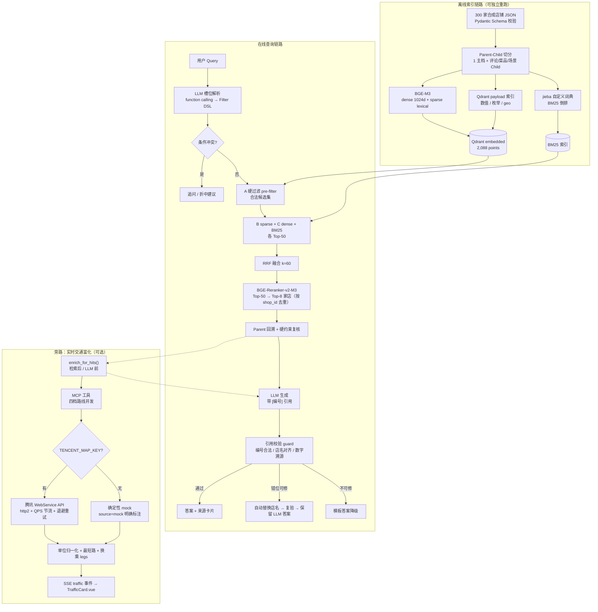

# 广州美食 RAG · 从零搭建的面试学习项目

> 一个**纯 CPU、零商业 API 关键依赖**的 RAG 全链路实现：从 300 家合成店铺数据出发，完成 Parent-Child 切分、BGE-M3 混合检索、Rerank、结构化硬约束、LLM 生成与引用校验、多轮会话、离线评估，以及检索后实时交通富化（MCP）。
> 目标不是做一个"能跑的 Demo"，而是把每一层的**设计取舍、失败模式与可量化证据**都做出来——一切以能被追问到底为标准。

[](https://www.python.org/)
[](https://fastapi.tiangolo.com/)
[](https://vuejs.org/)
[](https://qdrant.tech/)
[](#-测试与验证)

---

## 目录

- [一句话看懂这个项目](#一句话看懂这个项目)
- [核心亮点](#核心亮点)
- [整体架构](#整体架构)
- [三条架构红线](#三条架构红线)
- [技术栈与选型理由](#技术栈与选型理由)
- [目录结构](#目录结构)
- [核心实现](#核心实现)
  - [1. 数据层与 Parent-Child 切分](#1-数据层与-parent-child-切分)
  - [2. 检索层：三路召回 + RRF + Rerank](#2-检索层三路召回--rrf--rerank)
  - [3. 生成层：LLM 只在哑铃两端](#3-生成层llm-只在哑铃两端)
  - [4. 多轮会话与 Query 改写](#4-多轮会话与-query-改写)
  - [5. 实时交通富化与 MCP](#5-实时交通富化与-mcp)
  - [6. 评估体系](#6-评估体系)
- [快速开始](#快速开始)
- [服务与 API](#服务与-api)
- [评估结果](#评估结果)
- [测试与验证](#测试与验证)
- [已知边界与未落地项](#已知边界与未落地项)
- [文档索引](#文档索引)

---

## 一句话看懂这个项目

用户问"**西华路附近人均 30 以内、带爸妈吃的肠粉店，地铁方便吗**"，系统要：

1. 把自然语言拆成结构化条件（价格区间、商圈、场景、菜系、交通）；
2. 用**硬过滤 + 稠密 + 稀疏 + BM25** 四路协同召回，而不是把约束丢给向量"碰运气"；
3. 精排后按**店铺**去重（不是 chunk），回溯完整店铺主档；
4. 让 LLM 基于证据生成带引用编号的答案，**方案例数、数字可追溯**；
5. 可选地叠加实时交通（驾车/骑行/步行/公交四档），但**绝不污染检索与评估**；
6. 全程可评估、可消融、可复现。

---

## 核心亮点

| 亮点 | 说明 |
|---|---|
| **硬约束双保险** | pre-filter 保证召回集合合法 + 后置复核防 LLM 篡改；消融证明关掉后遵守率从 1.000 掉到 0.622 |
| **按店铺去重的 Rerank** | 把"chunk 级 Top-8 只覆盖 2~3 家店"修正为"店铺级 Top-8 覆盖 7~8 家"，Recall@8 **0.489 → 1.000** |
| **引用错位自动修复** | guard 检测"店名[N]与编号 N 不符"时精准替换店名、复验后保留 LLM 答案，而非整份降级 |
| **实时数据走旁路** | 交通是 post-retrieval enrichment：不进向量库、不参与 RRF/Rerank、不改 Top-K、不交给 LLM 编造， shops 指标严格不变 |
| **评估驱动优化** | 40 条 Gold Set + 5 组单变量消融 + 自实现 RAGAS + 优化前后对比，每一次改动都能归因 |
| **零 GPU 成本** | BGE-M3 / Reranker-v2-M3 本地 CPU 推理，现金成本接近 0 |

---

## 整体架构



**离线 / 在线解耦**：在线链路无状态；离线链路可独立重跑、灰度、切 collection alias。Qdrant embedded 单进程独占，评估时用 `RAG_QDRANT_PATH` 指向索引副本，可与在线服务并行。

---

## 三条架构红线

这三条是整个项目的"宪法"，所有取舍都由它们推导：

1. **硬约束前置过滤 + 后置复核，双保险**
   价格/商圈/过敏原/忌口/地铁等可结构化条件必须走 Qdrant payload filter（而非向量相似度）；软偏好（环境、口味）只影响排序、不影响准入。

2. **实时外部数据只做 post-retrieval enrichment**
   交通耗时、天气、排队等分钟级时效数据：不进向量库、不进 payload filter、不参与 RRF/Rerank 打分、不写回索引、不改变 Top-K 集合与顺序、不交给 LLM 生成事实，只由 API 层作为独立结构化字段合并。理由：维度是 `f(起点, 终点, 方式, 时刻)` 无法枚举，且会破坏 Gold Set 的可复现性。

3. **LLM 只用在"哑铃两端"**
   入口的槽位解析 + 出口的答案生成。中间链路（召回 / 融合 / 精排 / 复核 / Parent 回溯）与向量化入库全部用确定性代码与专用模型。LLM 只输出结构化 slots、绝不执行过滤；LLM 答案必须过引用校验，不过则降级。

---

## 技术栈与选型理由

| 组件 | 选择 | 为什么 |
|---|---|---|
| Embedding | **BGE-M3**（dense 1024d + sparse） | 单模型同时给稠密与词级稀疏表示，中文强；本地 CPU 可跑 |
| 稀疏兜底 | **jieba + BM25Okapi** + 自定义词典 | BGE-M3 sparse 是模型词表表示，对"啫啫煲/泮塘马蹄糕"等粤语专名仍可能未登录，需确定性兜底 |
| Reranker | **BGE-Reranker-v2-M3** | cross-encoder 精排，弥补双塔语义粒度不足 |
| 向量库 | **Qdrant embedded** | payload filter + geo_radius + 混合查询，零服务成本；embedded 单进程独占是已知约束 |
| 融合 | **RRF（k=60）** | 无需归一化不同检索分支的分数量纲，论文默认值稳健 |
| LLM | OpenAI 兼容接口（默认 `glm-5.3-flash`） | 只做槽位解析与答案生成；`RAG_LLM_*` 环境变量切换模型/端点 |
| 服务 | **FastAPI** + SSE | 异步流式、lifespan 一次加载模型、`run_in_threadpool` 不阻塞事件循环 |
| 前端 | **Vue 3 + Vite** | 多页面（对话 + 评估中心）、手写 SSE 解析、按 session 隔离状态 |
| 交通 | **自建 MCP Server**（JSON-RPC 2.0 / Streamable HTTP + stdio） | 不依赖官方 endpoint，纯协议实现语义一致；真实 key 只从环境变量读取 |

---

## 目录结构

```
gz-food-rag/
├── docs/                      # 13 篇设计与实现文档（方案/数据/检索/生成/评估/交通/Key配置）
├── data/
│   ├── raw/shops.jsonl        # 300 家合成种子店铺
│   ├── chunks/chunks.jsonl    # 2,388 个 Parent/Child chunk
│   └── qdrant/                # embedded 向量库（2,088 points）
├── scripts/
│   ├── gen_seed_data.py       # 固定 seed 生成 300 家店
│   ├── chunker.py             # Parent-Child 父子块切分
│   ├── build_index.py         # BGE-M3 双表示 → Qdrant
│   ├── retrieve/              # slots / filter DSL / 三路召回 / RRF / Rerank / 硬约束复核
│   ├── generate/              # LLM client / prompt / guard（引用校验+自动修复）/ 模板降级
│   ├── service/               # FastAPI：会话 / search / answer / SSE stream / eval API
│   ├── tests/                 # guard 修复单测
│   └── serve.py               # 主服务入口（:8000）
├── front/
│   ├── index.html             # 对话主页（含交通设置与卡片）
│   ├── eval.html              # 评估中心（总览 / 触发 / 对比 / 明细）
│   ├── src/api/               # REST + SSE 客户端
│   └── src/components/        # AnswerPanel / ShopCard / TracePanel / TrafficCard
├── traffic/                   # 独立旁路模块（:8100），零干扰主链路
│   ├── providers/             # 腾讯 WebService / 确定性 mock
│   ├── mcp_server/            # JSON-RPC 2.0 + HTTP + stdio 双传输
│   ├── normalize.py           # 单位归一化 / 最短路 / 换乘 legs / 粒度分级
│   ├── integration.py         # enrich_for_hits + prompt block（RAG 接入点）
│   └── tests/                 # 41 个单测（含真实腾讯响应结构回归）
├── eval/                      # Gold Set / 确定性指标 / 自实现 RAGAS / 消融 / 报告 / 对比
│   └── out/                   # 运行结果、judge 缓存、评估报告
└── README.md
```

---

## 核心实现

### 1. 数据层与 Parent-Child 切分

**Schema 的三个刻意设计**：

- `allergens`（安全红线）/ `avoid_ingredients`（偏好）/ `dietary_flags`（宗教文化）**分三字段**——混在一起会在"清真"与"不吃猪肉"上出错；
- 价格、步行分钟、辣度、评分**必须存数值**，否则无法 range filter，只能退化成语义匹配；
- `pros` / `cons` **分开存并独立成 chunk**——"环境嘈杂"若与好评混在一个 embedding 里，语义被稀释，搜"安静"反而会召回它。

**为什么不用固定 512 token 滑窗**：餐厅是实体型数据，字段强关联。固定切分会把"人均 18"和店名切到两块，导致过滤失效、LLM 张冠李戴——这是结构化 RAG 的经典翻车点。改为：

| 块类型 | 内容 | 数量 | 用途 |
|---|---|---|---|
| Parent | 全字段半结构化文本 + 摘要 | 1 / 店 | 最终送给 LLM 的上下文 |
| Child·评论 | 单条评论，pros/cons 独立 | 2~5 / 店 | 语义检索命中单元 |
| Child·菜品 | 招牌菜 + 描述 | 1~3 / 店 | 菜品级检索 |
| Child·场景 | 环境/氛围自然语言 | 1 / 店 | 承接"有烟火气""适合带爸妈" |

每个 Child 冗余复制父级硬约束字段（`district` / `price_per_person` / `allergens` / `geo`），命中 Child 后经 `parent_id` **回溯 Parent（small-to-big）**，无需二次 join。

### 2. 检索层：三路召回 + RRF + Rerank

```
Query → LLM 槽位解析 → Filter DSL
     → A 硬过滤（payload index / geo_radius）→ 合法候选集
     → B BGE-M3 sparse  Top-50
       C BGE-M3 dense   Top-50  （HNSW, cosine, L2 归一化）
       D jieba+BM25     Top-50
     → RRF(k=60) 融合 → Rerank Top-50 → 按 shop_id 去重取 Top-8 家店
     → Parent 回溯 + 硬约束后置复核 → token 预算裁剪
```

**店铺去重是关键修正**：早期 rerank 取 chunk 级 Top-8，同一家店的概览/菜品/口味块占满名额，8 个 chunk 只覆盖 2~3 家店——Recall 卡在 0.489，而消融显示"去掉 Rerank 反而 +0.278"。定位到根因后改为精排后按 `source_shop_id` 去重、每店留最高分块，**Recall@8 直接到 1.000**。

**三条铁律**：硬约束前置 + 后置；软偏好只排序不过滤；Query 改写（同义词 / Multi-Query / HyDE）只对稠密路生效，改写文本绝不参与硬过滤条件生成（否则会凭空造出"人均 50"这种约束）。

### 3. 生成层：LLM 只在哑铃两端

证据以 `--- [i] 店名（ID）---` 标注，末尾附**编号—店名对照表**，铁律要求逐字照抄店名（含 `·`）。生成后 guard 依次校验：

1. 引用编号必须来自召回集；
2. 店名与编号必须对齐（防高相似店名张冠李戴）；
3. 数字（人均/评分/步行分钟）必须能在证据中溯源；
4. 不得泄漏推理过程。

**引用错位自动修复**：种子数据里西华路肠粉有 6 家高度相似店名（广记灶/桥头灶/桥头轩…），LLM 曾把"广记灶"拼成数据里不存在的"广记姓[5]"。原逻辑只能整份降级，现在 `repair_citations()` 会把错店名精准替换为编号对应真实店名、复验通过后**保留 LLM 自然语言答案**；逐字流式新增 `corrected` 事件覆盖已吐出的错文本，前端显示"✓ 引用已校正"。修复不可行时才降级模板。

### 4. 多轮会话与 Query 改写

SQLite 持久化会话，每会话独立 settings（Top-K、LLM、交通开关、商圈、GPS）。fork 式 begin-turn 让"回答生成前切走再切回"不丢内容；Query 改写结合会话历史解析"附近""便宜点"这类指代；前端 SSE 手动解析 + 消息缓存，支持停止生成、刷新回显、跨会话设置隔离。

### 5. 实时交通富化与 MCP

独立 `traffic/` 模块（`:8100`），**检索后、LLM 前**旁路富化：

- **四档输出分级**：驾车/骑行/步行只给耗时与距离；公交给换乘 legs、线路名、票价、首末班；默认按最省时选路、平局再按最少换乘；
- **起点优先级链**：显式坐标 > 会话 > 浏览器 GPS（WGS84→GCJ-02）> 商圈中心 > IP 城市级（城市级拦截精细 mode）；
- **真实 / mock 双通道**：有 `TENCENT_MAP_KEY` 走腾讯 WebService（`--protocol http2` 兼容代理网络、QPS 令牌节流 + `status=120` 退避重试），无 key 走确定性 mock 并明确标注 `source=mock`；
- **MCP**：`mcp_server/server.py` 提供 5 个工具、JSON-RPC 2.0 + Streamable HTTP(`/mcp`) + stdio 双传输、Origin 校验、只绑 127.0.0.1；不装官方 SDK，纯协议实现；
- **降级矩阵**：超时/配额/城市级定位都有明确降级，缓存按网格化 + 时间桶，前端 `TrafficCard.vue` 展示并标注真实/模拟。

字段解析踩坑：腾讯真实响应用 `step.mode`（`WALKING`/`TRANSIT`）而非 `step.type`，simple 路线耗时在 `routes[0].duration`、公交段耗时在 `lines[0].duration`——曾有 41 个 mock 单测全绿但对真实 API 全军覆没，后补 5 个真实结构回归用例。

### 6. 评估体系

**指标分层**：确定性指标（Recall/Precision/MRR/HitRate/nDCG、硬约束遵守率、槽位字段准确率、店名覆盖率）做回归主指标；自实现 RAGAS（Faithfulness / Answer Relevancy / Context Precision / Context Recall）做语义补充。Gold Set 由结构化字段确定性过滤生成（seed=42），**不用被测 pipeline 自证**。

**消融单变量**：full / dense_only / no_rerank / no_hard_filter / rule_slots / chunk_topn（关去重）。RAGAS 只跑 full，按"样本+指标"缓存 judge 结果（缓存 key 带模型名，换 judge 自动失效）；judge 用 `deepseek-v4.1-flash`，与生成模型解耦以避免自评偏好。

**自实现 RAGAS 而非官方库**：环境依赖冲突（openai 旧版本 + ragas 新版）+ 可解释 + 成本可控的主动取舍；`docs/12` 给出交叉验证方案与决策矩阵。

---

## 快速开始

### 环境要求

- Python 3.10+（推荐 3.11/3.12），**CPU 即可**（首次需下载 BGE-M3 + Reranker 约 2.2GB 权重）
- Node.js 18+
- 一个 OpenAI 兼容的 LLM 端点（槽位解析 + 答案生成）

### 安装

```bash
# 1. Python 依赖
pip install fastapi uvicorn 'pydantic>=2' 'qdrant-client>=1.9' flagembedding \
    sentence-transformers torch jieba rank_bm25 'openai>=1.0' numpy \
    httpx pytest

# 2. 下载模型到本地目录（或改 scripts/retrieve/config.py 与 build_index.py 中的模型路径）
#    BGE-M3:            BAAI/bge-m3
#    BGE-Reranker-v2-M3: BAAI/bge-reranker-v2-m3

# 3. 前端依赖
cd front && npm install && cd ..
```

### 配置 LLM

```bash
export RAG_LLM_API_KEY="your-api-key"
export RAG_LLM_BASE_URL="https://your-openai-compatible-endpoint/v1"
export RAG_LLM_MODEL="glm-5.3-flash"
```

### 构建索引并启动

```bash
# 1. 生成种子数据（300 家，固定 seed）→ 切分 → 建索引（首次约 10-20 分钟 CPU）
python scripts/gen_seed_data.py
python scripts/chunker.py
python scripts/build_index.py --recreate

# 2. 启动后端（首次加载模型约 60s）
python scripts/serve.py --port 8000

# 3. 启动前端
cd front && npm run dev      # http://localhost:5173
```

打开 `http://localhost:5173` 对话；`http://localhost:5173/eval.html` 评估中心；后端文档 `http://localhost:8000/docs`。

### 可选：交通富化

```bash
# 无 key 也能跑（确定性 mock，页面标注"模拟数据"）
python -m traffic.serve                     # MCP / 富化服务 :8100，演示页 /demo

# 有腾讯地图 key：编辑 traffic/.env.local（见 traffic/.env.local.example）
# TENCENT_MAP_KEY=你的key → 后端自动切真实 WebService API
# 后端 /health 中 traffic_configured=true 即生效
```

> 真实 key 只从环境变量读取，`.env.local` 已被 `.gitignore` 排除，绝不入库。

---

## 服务与 API

**后端 `:8000`**（完整列表见 `/docs`）

| 方法 | 路径 | 说明 |
|---|---|---|
| GET | `/health` | 模型/LLM/交通配置状态、索引点数 |
| POST | `/api/sessions` | 创建会话 |
| GET / DELETE | `/api/sessions/{id}` | 会话列表 / 详情 / 删除 |
| POST | `/api/sessions/{id}/begin-turn` | 开启一轮（fork 式，防切会话丢内容） |
| POST | `/api/search` | 只看检索结果（含 trace），不调 LLM |
| POST | `/api/answer` | 完整答案（含 shops / traffic / guard 结果） |
| POST | `/api/answer/stream` | SSE 流式，事件：`meta / token / answer / guard / corrected / fallback / clarify / done / error` |

请求体可选字段：`enable_traffic`、`traffic_area`、`traffic_origin`、`client_gps`、`use_ip`、`prefer_llm_slots`、`buffer_guard` 等。

**评估 API**：`/api/eval/config|runs|compare|run|tasks`（触发评估、异步任务、历史对比）。

**交通服务 `:8100`**：`/health`、`POST /api/enrich`、`/demo`、`/mcp`（JSON-RPC 2.0）。

---

## 评估结果

同一 Gold Set（40 条，12 正常 + 2 冲突用于主表）、同一消融配置，三项优化前后的完整系统对比：

| 指标 | 基线 | 优化后 | 变化 |
|---|---:|---:|---:|
| Recall@8 | 0.489 | **1.000** | +0.511 |
| nDCG@8 | 0.615 | **1.000** | +0.385 |
| Context Recall | 0.491 | **0.997** | +0.506 |
| 冲突追问命中率 | 0.500 | **1.000** | +0.500 |
| Answer Relevancy | 0.766 | 0.797 | +0.031 |
| Faithfulness | 0.995 | 0.998 | +0.003 |
| 硬约束遵守率 | 1.000 | 1.000 | 持平 |
| 平均延迟 | 28.416s | 25.276s | -3.140s |

**三项优化**：① Rerank 按 `shop_id` 去重（Recall 提升的主因，`chunk_topn` 关去重复现基线 0.495，消融隔离可归因）；② RAGAS judge 换独立模型 `deepseek-v4.1-flash`；③ 冲突词表从 4 个明示词扩到 60+。

**消融的关键发现**（基线）：关掉硬约束遵守率 1.000 → 0.622（双保险有效）；仅 Dense 单路 Recall -0.140；chunk 级 rerank 曾使 Recall -0.278（暴露去重缺失）。详见 `docs/10`、`docs/11`。

> 说明：数据为合成（固定 seed），指标绝对值不可直接外推到线上，但组件间相对差异与归因结论有参考价值；小样本下 Δ<0.02 视为不显著。

---

## 测试与验证

```bash
python -m unittest discover -s traffic/tests -v   # 41 passed：四档/mock/真实腾讯结构/MCP/定位/缓存
python -m unittest discover -s scripts/tests -v   # 7 passed：引用错位修复（可修/不误伤/复验/非法编号）
```

端到端已验证：SSE 事件序列、`enable_traffic` 开/关时 shops 完全一致（RAG 指标不变性）、真实腾讯 key 下四档 12 方案全部可用零降级、刷新回显与跨会话隔离。

---

## 已知边界与未落地项

诚实地列出边界，避免"看起来什么都做了"：

- **多模态文档摄取**：`docs/01` 已给出 PDF/DOCX/XLSX/HTML/图片 → `DocElement IR` 的完整方案，但**当前代码未实现摄取层**，实际入库的是合成结构化种子数据。
- **交通 RAG 指标消融**：富化是只读旁路、不改 shops，逻辑上不影响 Recall/NDCG；有单测证明不变性，但**未做真实查询的重跑消融**。
- **官方托管 MCP Server**：仅有 Client 框架（`HttpMcpClient`），未配真实官方 endpoint；当前用自建 Server。
- **交通 route_matrix**：腾讯 provider 当前复用逐目的地逻辑，未走 matrix 批量接口优化。
- **Quick Tunnel 演示脚本**：`start_tunnel.bat`（本地用、未入库）用于临时公网演示，非生产部署方案。
- **评估成本**：RAGAS 每样本 4~5 次 judge 调用，纯 CPU 下单轮检索 15~20s，默认只跑有限样本。

---

## 文档索引

| 文档 | 内容 |
|---|---|
| `docs/00-方案规划.md` | 需求拆解、维度→通道映射、总体架构、Schema、选型论证、阶段路线、踩坑清单 |
| `docs/01-文档摄取与多模态向量化.md` | 多格式解析 → DocElement IR 方案（设计） |
| `docs/02-实时交通富化与MCP集成.md` | 边界论证、MCP 设计、失败模式、落地状态 §15 |
| `docs/03-数据字典.md` | 300 家种子数据字段定义 |
| `docs/04-父子块切分实现详解.md` | Parent-Child 切分实现 |
| `docs/05-检索层实现详解.md` | 槽位 / 三路召回 / RRF / Rerank / 复核 |
| `docs/06-大模型引入分析与生成层实现.md` | LLM 介入阶段分析、生成与 guard |
| `docs/08-FastAPI服务层.md` | 服务层设计 |
| `docs/09-多轮会话与query改写.md` | 会话、改写、SSE 交互 |
| `docs/10-评估系统与报告.md` | 评估方法、主结果、消融、偏差 |
| `docs/11-优化前后对比报告.md` | 三项改进的归因验证 |
| `docs/12-RAGAS自实现与官方库对比.md` | 取舍分析与交叉验证方案 |
| `docs/13-腾讯MapKey配置与RAG接入指南.md` | Key / 白名单 / 配额诊断 / 业务接入 |

---

## License

学习与面试演示用途。店铺数据均为合成数据，不含真实商业平台内容。
