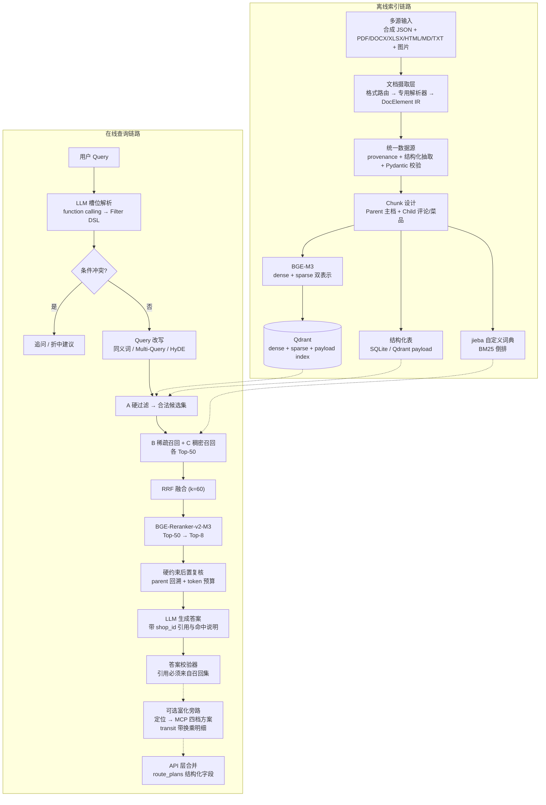

# 广州美食 RAG 系统｜从零搭建方案规划 v1.4

> 定位：一个**能跑通、能讲透、能写进简历**的 RAG 学习项目。
> 主题：按「位置 / 口味 / 交通 / 菜系 / 喜好 / 忌口 / 价格 / 环境 / …」多维条件检索广州美食。
> 本文件只做方案规划与选型论证；落地代码在后续 Phase 中按本文件的目录树逐步生成。
> **v1.1 变更**：补上文档摄取层（PDF / DOCX / XLSX / HTML / MD / TXT / 图片）与多模态向量化，详见 `docs/01-文档摄取与多模态向量化.md`；离线链路、数据来源、选型表、目录树、Phase 1、坑表同步修订。
> **v1.2 变更**：新增「Top-K 之后的实时交通富化 + MCP 集成」评估，详见 `docs/02-实时交通富化与MCP集成.md`；新增架构红线 2（实时外部数据只做 post-retrieval enrichment，不进索引、不进过滤、不参与打分、不进 LLM 事实生成）、Phase 5.5、合规要求与 10 道新增面试追问。
> **v1.3 变更**：按用户确认，把 Phase 5.5 的四档交通输出改为**分级粒度** —— 公共交通给完整换乘明细（线路 / 上下车站 / 中间步行多久，多方案默认取用时最少），驾车 / 骑行 / 步行只给参考耗时。详见 `docs/02-实时交通富化与MCP集成.md` v1.1；§1.1、§2 mermaid、§4.0 选型表、§6 Phase 5.5、§7 坑表、§8 面试追问同步修订。

---

## 0. 先看本机环境：选型的第一约束

| 项 | 实测结果 | 对选型的直接影响（根因） |
|---|---|---|
| OS / Shell | Windows / Git Bash | 路径、Docker volume、jieba 词典编码要注意 UTF-8 |
| Python | 3.13.14（托管运行时） | 部分包（如某些旧版 `rank_bm25` / `torch`）对 3.13 的 wheel 支持滞后 → **建议为本项目单独建 venv，优先 Python 3.11**，3.13 作为备选 |
| GPU | 无 NVIDIA 独显（`nvidia-smi` 不存在） | **本地 7B/8B LLM 直接出局**（FP16 需 ~15GB 显存，4bit 量化仍需 6~8GB 且 CPU 推理极慢）→ 生成层必须走云 API 或 1.5B/3B 的 CPU 小模型 |
| Docker | 28.1.1 可用 | Qdrant 可以起容器；但学习期用 **Qdrant 本地 embedded 模式**零依赖更快 |
| 代理 | 存在 `http://127.0.0.1:20815` | 拉 HuggingFace 模型、调云 API 需要走代理；本地回环请求要 `--noproxy '*'`（否则 530 误判） |
| 内存/磁盘 | 未量化，按 16GB / 10GB 空闲估计 | BGE-M3 FP16 ~1.2GB 权重，CPU 可跑；2k~5k chunk 索引 < 200MB |

**结论（写进面试回答的一句话）**：没有 GPU 时，RAG 里最贵的不是向量检索，而是「生成」；因此把算力预算全押在云 LLM，本地只保留轻量 Embedding / Reranker，是最省成本又最能跑通全链路的分工。

---

## 1. 需求拆解

### 1.1 输入输出契约

- **输入**：自然语言 query，可混杂口语、粤语词、多个条件、否定条件、条件冲突。
  - 例：`"珠江新城附近，人均 80 以内，粤菜，别太吵，不要香菜和花生，地铁走路 10 分钟内，适合带爸妈去，有点老广味道"`
- **输出**：Top-N 店铺卡片，每条必须包含
  1. 命中了哪些硬条件、哪些软偏好（可解释）
  2. 来源引用（`shop_id` + 命中的 chunk_id，可回溯）
  3. 明确的「未满足 / 信息缺失」说明，而不是含糊带过
  4. 条件冲突时的追问或折中方案
  5. （可选）`route_plans`：Top-K 每家店的交通方案，**独立于答案的结构化字段**，由交通富化层在筛选后并行补齐（v1.3，见 `02-实时交通富化与MCP集成.md`）。**输出分级**：`transit` 给完整换乘明细（线路 / 上下车站 / 换乘步行时长 / 票价，多方案默认取用时最少的一条）；`driving / cycling / walking` **只给参考耗时**，不返回路径明细
- **不可妥协的红线**：忌口 / 过敏原 / 预算上限 / 行政区 / 距离 / 营业时段属于**硬约束**，满足率必须 100%，不能靠语义相似度"差不多"。

> 这条红线是整个系统架构的**第一性原理**，后面所有设计（pre-filter、字段冗余、后置复核、评估指标）都从它推导出来。

### 1.2 检索维度全集（用户给的 8 项 + 补全）

| # | 维度 | 典型用户说法 | 数据类型 | 检索通道 | 硬/软 |
|---|---|---|---|---|---|
| 1 | 位置·行政区 | "越秀区""天河" | 枚举 | A 结构化过滤 | 硬 |
| 2 | 位置·商圈 | "西华路""北京路""珠江新城" | 枚举 | A + B 关键词 | 硬 |
| 3 | 位置·经纬度半径 | "我附近 2 公里""体育西路地铁站附近" | `geo_point` + 半径 | A geo_radius 过滤 | 硬 |
| 4 | 菜系 | "粤菜""潮汕牛肉火锅""东南亚菜" | 枚举数组 | A 过滤 | 硬（通常） |
| 5 | 口味 | "清淡""重口""镬气足""偏甜" | 标签 + 文本 | C 语义 + A 标签 | 软 |
| 6 | 口味·程度 | "不要辣""微辣""少油少盐" | 数值 0~5 | A 范围过滤 | 硬（"不要辣"=0） |
| 7 | 交通便利·地铁 | "1 号线沿线""陈家祠站" | 枚举 + 步行分钟 | A 过滤 | 硬 |
| 8 | 交通便利·步行距离 | "走路 10 分钟内" | 数值 | A 范围过滤 | 硬 |
| 9 | 交通便利·停车 | "要能停车""开车去" | 布尔 | A 过滤 | 硬 |
| 10 | 价格·人均区间 | "人均 50~80""别超过 100" | 数值 min/max | A 范围过滤 | 硬 |
| 11 | 价格·性价比 | "抵食""学生党""平靓正" | 标签 + 评论文本 | C 语义 + B 词典 | 软 |
| 12 | 环境·噪音 | "安静""别太吵""适合聊天" | 枚举 + 评论文本 | A + C | 软/可硬 |
| 13 | 环境·包间/座位 | "要有包间""吧台位""有户外位" | 布尔/枚举 | A 过滤 | 硬 |
| 14 | 环境·装修氛围 | "有烟火气""适合拍照""老字号装修" | 文本 | C 语义 | 软 |
| 15 | 喜好·场景 | "约会""家庭聚餐""一人食""商务宴请""带娃""带宠物" | 枚举数组 | A + C | 软（带娃/宠物可硬） |
| 16 | 喜好·菜品级 | "哪家肠粉最正宗""想吃艇仔粥" | 招牌菜数组 + 评论 | B 关键词 + C | 软 |
| 17 | 喜好·榜单/口碑 | "米其林""黑珍珠""必吃榜""老字号" | 枚举 + 评分 | A 过滤 + B | 硬/软 |
| 18 | 忌口·食材 | "不要香菜""不吃内脏""不要葱" | 黑名单数组 | A 集合过滤 | **硬** |
| 19 | 忌口·过敏原 | "花生过敏""海鲜过敏""乳糖不耐" | 过敏原数组 | A 集合过滤 | **硬（最高优先级）** |
| 20 | 忌口·饮食规范 | "清真""全素""不吃猪肉" | 枚举 | A 过滤 | **硬** |
| 21 | 健康取向 | "低嘌呤""控卡""低糖""少油" | 标签 | A + C | 软（痛风可硬） |
| 22 | 时间·营业 | "现在还开着""夜宵""早茶" | 结构化时段 | A 过滤 | 硬 |
| 23 | 时间·排队 | "不想排队""排队少于 15 分钟" | 数值 | A 范围过滤 | 硬/软 |
| 24 | 时间·时令 | "秋天吃蟹""当季限定" | 枚举 + 文本 | A + C | 软 |
| 25 | 服务 | "能提前订位""可开发票""有外卖" | 布尔 | A 过滤 | 硬 |
| 26 | 口碑·评分 | "评分 4.5 以上""评论多的" | 数值 | A 过滤 + 排序 | 硬（下限） |
| 27 | 文化/语言 | "老广口味""游客友好""有图片菜单" | 标签 + 文本 | C 语义 | 软 |
| 28 | 负面信息 | "有没有踩雷""争议点" | 评论 cons 字段 | C 语义（单独加权） | 软 |
| 29 | 排序意图 | "按距离最近""按评分排" | 枚举 | 排序策略（非检索） | 硬 |

**补全逻辑（面试可讲）**：把用户口中的"条件"按三个轴拆开——
① **可枚举 / 可度量 / 可否定** → 结构化字段；② **主观、连续、需要语感** → 语义向量；
③ **必须精确命中的专名**（店名、菜名、地铁站、榜单）→ 关键词倒排。
任何没被归进这三类的维度，最后都会变成"LLM 自己瞎猜"，这是 RAG 效果崩掉的常见根因。

### 1.3 维度 → 检索通道映射（核心设计）

| 通道 | 覆盖维度 | 实现 | 失败会怎样 |
|---|---|---|---|
| **A 结构化硬过滤（pre-filter）** | 1~4、6~11(数值部分)、12~13、17~24 的枚举/数值部分、25~26 | Qdrant payload index / SQL WHERE / `geo_radius` | 不前置 → 向量把"人均 500 的店"召回给"人均 80 以内" |
| **B 稀疏/关键词** | 店名、招牌菜、地铁线、榜单、粤语专名 | BGE-M3 sparse + jieba/BM25 双路 | 纯向量对"泮塘马蹄糕""啫啫煲"这类专名不敏感 |
| **C 稠密语义** | 口味、氛围、场景、"适合带爸妈"、负面评价 | BGE-M3 dense 1024 维 + HNSW | 只有关键词会漏掉"有烟火气"这类抽象表达 |
| **D LLM 推理** | 条件冲突、权衡、解释、追问、生成 | 云 LLM + function calling | 让 LLM 承担过滤 = 幻觉 + 不可复现 |

**三条铁律**：
1. **硬约束前置过滤 + 后置复核，双保险**。前置保证召回集合合法，后置保证生成答案没有被 LLM 篡改或编造。
2. **软偏好只影响排序，不影响准入**。
3. **HyDE / 查询改写只对 C 通道生效**，改写后的文本绝不参与 A 通道的过滤条件生成（否则会凭空造出"人均 50"这种约束）。

**架构红线 2（v1.2 新增）**：实时外部数据（交通耗时、天气、排队）只做 **post-retrieval enrichment** —— 不进向量库、不进 payload filter、不参与 RRF / Rerank 打分、不写回索引、不改变 Top-K 集合与顺序，也不交给 LLM 生成事实，只由 API 层作为独立结构化字段合并。根因：时效分钟级、维度 = f(起点,终点,方式,时刻) 无法枚举、成本与配额、以及会破坏 golden set 的可复现性。

**架构红线 3（v1.4 新增）**：LLM 只用在「哑铃两端」—— 入口的**槽位解析**（自然语言理解）与出口的**答案生成**（语言组织）。中间链路（三路召回 / RRF / Rerank / 硬约束复核 / Parent 回溯）以及**向量化入库**全部不用生成式 LLM，用确定性代码与专用模型（BGE-M3 / BGE-Reranker）。判断标准：语义理解与生成 → 用 LLM；精确过滤与稳定排序 → 用代码。两条子规则：① LLM 只输出结构化 slots，绝不执行过滤；② LLM 答案必须过引用校验（编号合法 / 店名对齐 / 数字溯源 / 无推理泄漏），不过则降级模板。实测依据与踩坑见 `docs/06-大模型引入分析与生成层实现.md`。

---

## 2. 总体架构



**为什么是"离线 / 在线"两条链路**：面试里最容易被问"数据更新怎么办"。两条链路解耦后，在线链路完全无状态，离线链路可以独立重跑、灰度、版本切换（`model_version` + collection alias）。

---

## 3. 数据层设计（最容易被跳过、面试最爱深挖）

### 3.1 数据来源与合规

- **不爬商业点评平台**：TOU / 反爬 / 数据合规风险，学习项目没必要碰。
- **v1.1：数据来源改为双通道**（详见 `01-文档摄取与多模态向量化.md`）：
  - **通道一 · 结构化种子数据**：合成 JSON，字段齐全、可控，用于保证硬约束链路与评估可复现。
  - **通道二 · 多格式文档语料**：真实格式的 PDF 菜单 / XLSX 店铺清单 / HTML 攻略 / DOCX 报告 / MD 笔记 / TXT / 图片截图，经**文档摄取层**解析成统一 `DocElement IR` 后，汇入同一个 `Shop` / `Chunk` 模型。
  - 两通道最终都走同一套 Parent-Child → BGE-M3 → Qdrant，下游零改动。补齐这层的意义：企业 RAG 落地的大头工作量在解析，且**解析质量是检索效果的上限**。
- **方案（通道一）**：以**虚构店名 + 真实地理与饮食文化要素**构造种子数据集，约 **300 家店 × 1 主档 + 3~8 条评论/菜品 chunk ≈ 2000~2500 chunks**。
  - 真实要素：行政区、商圈、地铁线路站点、粤菜菜名、饮食文化词（早茶、镬气、老字号、泮塘）。
  - 虚构要素：店名、评分、人均、营业时间、评论内容。全部打 `synthetic: true` 标记。
- **为什么要虚构店名**：避免给真实商户编造价格/评分造成事实误导；同时面试时可以坦荡说明"数据合规处理"，反而是加分项。
- **规模为什么不大**：2000 chunk 单机 CPU 几分钟可完成全量嵌入，能完整演示 HNSW、pre-filter、RRF、rerank、评估、增量更新所有环节；等链路跑通再扩到 10 万条才有意义。**先跑通再扩容**是可落地性的关键。
- 生成方式：写 `scripts/gen_seed_data.py`，用云 LLM 按固定 JSON Schema 批量生成 + 固定 seed + Pydantic 强校验 + 人工抽检 30 条。

### 3.2 Schema（完整字段定义）

```json
{
  "shop_id": "GZ-LW-0042",
  "name": "穗香居·西华路肠粉",
  "aliases": ["西华路穗香", "穗香肠粉"],
  "synthetic": true,
  "district": "荔湾区",
  "business_area": "西华路",
  "address": "荔湾区西华路 xxx 号",
  "geo": {"lat": 23.1288, "lon": 113.2461},
  "nearest_metro": [{"line": "1号线", "station": "陈家祠", "walk_min": 6}],
  "parking": false,
  "cuisine": ["粤菜", "广式点心"],
  "dishes": ["鲜虾肠粉", "艇仔粥", "及第粥"],
  "taste_tags": ["清淡", "米香浓郁", "豉油偏甜"],
  "spiciness": 0,
  "sweetness": 2,
  "oily_level": 1,
  "price_per_person": 18,
  "price_band": "0-30",
  "value_for_money": 4.6,
  "scene_tags": ["一人食", "早餐", "本地街坊"],
  "env_tags": ["街边小店", "嘈杂", "烟火气"],
  "noise_level": "吵",
  "private_room": false,
  "outdoor_seating": false,
  "opening_hours": [{"open": "06:30", "close": "14:00", "days": [1,2,3,4,5,6,7]}],
  "is_late_night": false,
  "is_dim_sum": true,
  "queue_min": 15,
  "reservation": false,
  "takeaway": true,
  "rating": 4.5,
  "review_count": 1280,
  "awards": ["老字号"],
  "since_year": 1998,
  "allergens": ["花生", "虾/甲壳类", "麸质", "海鲜"],
  "avoid_ingredients": ["香菜"],
  "dietary_flags": ["含猪肉", "非清真"],
  "health_tags": ["低油"],
  "season_tags": ["全年"],
  "pros": ["肠粉皮薄透亮", "镬气足", "平靓正"],
  "cons": ["下午两点后常售罄", "座位少要拼桌", "环境嘈杂"],
  "service_tags": ["可开发票"],
  "source_url": null,
  "model_version": "bge-m3@2026-11",
  "updated_at": "2026-11-05T00:00:00+08:00"
}
```

**字段设计的三个刻意决定（面试讲点）**：
1. `allergens` / `avoid_ingredients` / `dietary_flags` **分三个字段**：过敏原（安全红线）、忌口食材（偏好）、饮食规范（文化/宗教），语义不同，混在一起会在"清真"和"不吃猪肉"上出错。
2. 数值字段（`price_per_person` / `walk_min` / `spiciness` / `rating`）**必须存数值**，不能存 `"人均 50 左右"` 字符串——否则无法做 range filter，只能退化成语义匹配。
3. `pros` / `cons` **分开存**：评论里"环境嘈杂"是负面，如果和正面评论混在一个 chunk 里做 embedding，语义会被稀释，导致"安静"反而召回这家店。负面信息单独成 chunk 并给独立权重。

### 3.3 Chunk 策略：Parent-Child（父子块）

**为什么不用固定 512 token 滑窗切分**：餐厅是**实体型数据**，字段之间强关联。固定切分会把"人均 18"和店名切到两个 chunk，导致 ① 过滤失效 ② LLM 张冠李戴（把 A 店的价格安到 B 店）。这是 RAG 在结构化场景下的经典翻车点。

| 块类型 | 内容 | 数量 | 用途 |
|---|---|---|---|
| **Parent** | 店铺主档：全字段渲染成半结构化文本 + 一句话摘要 | 1 / 店 | 最终送给 LLM 的上下文 |
| **Child · 评论** | 单条评论/一组同类评价（pros 或 cons 独立） | 2~5 / 店 | 语义检索的命中单元，粒度细、语义纯 |
| **Child · 菜品** | 单个招牌菜 + 描述 + 相关评价 | 1~3 / 店 | 菜品级检索（"哪家肠粉最正宗"） |
| **Child · 场景** | 环境/氛围/适合场景的自然语言描述 | 1 / 店 | 承接"有烟火气""适合带爸妈"这类抽象 query |

**关键实现细节**：
- 每个 Child 的 payload **冗余复制父级硬约束字段**（`district`、`price_per_person`、`allergens`、`geo`、`opening_hours` 等）。否则 pre-filter 只能在 parent 层做，命中 child 后还要二次 join，复杂且易漏。
- Child 带 `parent_id`；检索命中 Child → 回溯 Parent 作为 LLM 上下文（**small-to-big**）。
- 每个 chunk 写 `chunk_type`、`model_version`、`source_shop_id`，便于评估时做归因。

**Parent 文本模板（既适合 embedding 也适合人读）**：

```
【店铺】穗香居·西华路肠粉（别名：西华路穗香）｜ID GZ-LW-0042
【位置】荔湾区 / 西华路｜地铁 1 号线陈家祠站步行 6 分钟｜无停车位
【菜系】粤菜·广式点心｜招牌：鲜虾肠粉、艇仔粥、及第粥
【口味】清淡、米香浓郁、豉油偏甜；辣度 0/5，甜度 2/5，油 1/5
【价格】人均 ¥18（区间 0-30）｜性价比 4.6｜不支持团购
【环境】街边小店、嘈杂、无包间、需拼桌、烟火气足｜适合一人食/早餐/街坊，不适合商务宴请
【时间】06:30-14:00，早茶时段排队约 15 分钟｜不做夜宵
【忌口与过敏】含花生、虾/甲壳类、麸质、海鲜；含猪肉、非清真；无香菜
【口碑】评分 4.5（1280 条）｜1998 年开业，老字号
【好评】"肠粉皮薄透亮，镬气足""平靓正"
【争议】"下午两点后常售罄""座位少要拼桌""环境嘈杂"
```

> 这种"字段标题 + 值"的半结构化文本，比纯 JSON 更适合 embedding（有自然语言连接），又比自由文本更利于保持字段边界。

### 3.4 索引设计

| 索引 | 内容 | 参数 | 说明 |
|---|---|---|---|
| Dense | BGE-M3 dense，1024 维，**L2 归一化后 cosine** | HNSW：`M=16`、`efConstruction=200`、`efSearch=64~128` | 归一化是硬要求，否则 cosine ≠ 内积 |
| Sparse | BGE-M3 sparse（lexical weights，词级权重） | 倒排索引 | 相比 BM25 的优势：权重由模型学出，能处理一定的语义词扩展 |
| BM25 | `jieba` 分词 + 自定义词典 + `rank_bm25.BM25Okapi` | `k1=1.5, b=0.75` | 兜住专名精确匹配；自定义词典收广州地名/菜名 |
| Payload index | `district`、`price_per_person`、`cuisine`、`allergens`、`noise_level` 等 | Qdrant payload index | 让 pre-filter 走索引而非全表扫描 |
| Geo | `geo` 字段存 `{"lat":..., "lon":...}` | Qdrant `geo_radius` filter | 球面距离，别用行政区代替"附近" |
| 自定义词典 | 西华路、上下九、泮塘、艇仔粥、啫啫煲、及第粥、镬气、抵食、平靓正、老广、陈家祠… | `jieba.load_userdict()` | 防专名被切碎 |

**为什么 Dense + Sparse + BM25 三路而不是两路**：BGE-M3 的 sparse 已经很强，但它是**模型词表**上的稀疏表示，对中文新词/专名/粤语口语仍可能未登录；jieba + 自定义词典的 BM25 是确定性兜底。三者错误模式不同，融合才稳定——这是能在面试里讲出深度的地方。

---

## 4. 模型与组件选型（逐项论证）

### 4.0 选型总表

| 环节 | 选中方案 | 主备选 | 一句话理由 |
|---|---|---|---|
| Embedding | **BGE-M3**（本地 CPU / FP16） | bge-large-zh-v1.5 / text-embedding-3-small | 单模型同时产出 dense + sparse + multi-vector，中文强、可本地、零调用费 |
| Reranker | **BGE-Reranker-v2-M3**（本地 CPU，Top-50→Top-8） | FlashRank(ONNX) / 云端 Rerank API | 与 M3 同族，cross-encoder 修正"语义相近但条件不符" |
| 槽位解析 LLM | **兼容 OpenAI 格式的云 API**（DeepSeek / Qwen-Plus / GLM-4-Flash） | 本地 Ollama qwen2.5:3b | 无 GPU；结构化 JSON 输出质量决定整个硬过滤的正确性 |
| 答案生成 LLM | 同上，抽象 `LLMClient` 可切换 | 本地 1.5B/3B | 中文好、便宜、支持 JSON mode；本地 7B 不可行 |
| 向量库 | **Qdrant**（embedded 起步 → Docker 生产） | FAISS / Elasticsearch / pgvector | 原生 payload pre-filter + dense + sparse + geo，一套搞定 |
| 融合 | **RRF (k=60)** | weighted sum / LTR | 不同检索分数不可比，RRF 只用排名、无需调参 |
| 评估 | 自建 golden set + **RAGAS** + 硬约束满足率 | 纯人工 | 检索看 Recall/NDCG，生成看 faithfulness |
| 服务 | FastAPI + Pydantic v2 | Flask | 类型校验直接复用数据 schema |
| 文档解析 | PyMuPDF / python-docx / openpyxl / trafilatura | MarkItDown / Unstructured | 专用解析器保住版面坐标与 provenance，统一 IR 屏蔽格式差异 |
| OCR / 多模态 | RapidOCR(ONNX CPU) + 云 VLM caption → 文本化 | 图像 embedding 双索引 / ColPali | 无 GPU 下文本化收益最高；重模型只做原理对照 |
| 工具协议 | **MCP**（自建 Server 为主 + 官方 Server 对照），确定性编排 | 纯 function calling | FC 与 MCP 分层而非二选一；MCP 覆盖传输层、能力协商、安全边界 |
| 地图服务 | **腾讯位置服务**（合规白名单，默认） | 高德 / 百度（可换适配层） | 四种路径规划 + 距离矩阵 + IP 定位齐备，公交接口原生返回 `steps[]` 换乘明细，正好满足分级输出；Mapbox / OSM / Google 禁用 |

### 4.1 Embedding：为什么是 BGE-M3

| 候选 | 中文能力 | 输出形式 | 维度 / 长度 | 本地可跑 | 成本 | 主要短板 |
|---|---|---|---|---|---|---|
| **BGE-M3** | 强（C-MTEB 第一梯队，100+ 语言） | **dense + sparse + ColBERT multi-vector** | 1024 / 最长 8192 token | ✅ CPU 可跑，~1.2GB | 0 | 模型偏大，CPU 首次编码慢 |
| bge-large-zh-v1.5 | 中文短文本极强 | dense only | 1024 / 512 token | ✅ ~1.3GB | 0 | 需另配 BM25 才有稀疏；长文本受限 |
| m3e-base | 中文尚可 | dense only | 768 / 512 | ✅ 轻 | 0 | 老模型，长文本与多语言弱 |
| Qwen3-Embedding-0.6B | 强，2025 新系列 | dense | 可调维 / 长上下文 | ✅ 轻 | 0 | 无原生 sparse，生态示例少于 BGE |
| text-embedding-3-small | 中文中等 | dense only | 1536（可缩） | ❌ 闭源 | 按 token 计费 | 无稀疏、数据出境、中文语感弱于国产 |
| jina-embeddings-v3 | 多语言强 | dense（Matryoshka） | 1024 可缩 | 可本地 | 有 API 费 | 中文垂类不一定优于 BGE |

**选 BGE-M3 的四条理由**：
1. **一个模型同时给 dense / sparse / multi-vector**，混合检索不需要再维护第二个模型，工程复杂度和显存都减半。这是它相对其他所有候选的结构性优势。
2. **中文 + 长上下文 8192**：可以把整个 Parent 主档（含全部字段）一次性编码，不必切碎。
3. **完全本地、开源可商用、零调用费**：面试项目要能反复重跑、做消融实验，不能让 API 账单成为变量。
4. **面试可讲深度**：dense（双塔，可预计算）/ sparse（词级权重，可倒排）/ multi-vector（ColBERT 后期交互）三种检索范式的取舍，一个模型全讲完。

**不选谁、为什么**：
- 不选 `text-embedding-3-small` 作主选：中文餐饮口语（"抵食""镬气""老广"）语感弱，且没有 sparse，混合检索要另起炉灶；数据出境在学习项目里也没必要。
- 不选 `bge-large-zh-v1.5` 作主选：中文短文本确实略强，但只有 dense，还得额外搭 BM25；且 512 token 装不下含评论的主档。**把它列为"若只做短 query 召回可替换"的对照实验项**，正好用于消融。
- 不选 m3e：2023 年的模型，长文本与多语言是明显短板，没有理由在新项目里选它。

**落地细节**：
```bash
pip install FlagEmbedding sentence-transformers
# 首次会下载 ~2.2GB 权重；国内建议设置 HF_ENDPOINT 并走本机代理
from FlagEmbedding import BGEM3FlagModel
model = BGEM3FlagModel('BAAI/bge-m3', use_fp16=False)   # 无 GPU 必须 False
out = model.encode(docs, return_dense=True, return_sparse=True, return_colbert_vecs=False)
```
- **CPU 无 GPU 的降级路径**：先装轻量的 `bge-small-zh-v1.5`（~100MB）把全链路跑通，再换 BGE-M3 做正式索引；代码里用 `EmbeddingClient` 接口隔离，切换只改配置。
- **加速**：ONNX Runtime / `optimum` 量化、批量 encode（batch_size=16~32）、结果落盘缓存（`numpy .npy`），避免每轮调试都重算。
- **必须记录 `model_version`**：换模型要全量重嵌入，索引 collection 名带版本号，用 alias 原子切换。

### 4.2 Reranker：为什么必须有，为什么选 v2-M3

| 候选 | 类型 | 本地 CPU | 与中文 | 说明 |
|---|---|---|---|---|
| **BGE-Reranker-v2-M3** | cross-encoder | 可跑（30~50 条约数秒~十几秒） | 强 | 与 BGE-M3 同族，多语言 |
| bge-reranker-large | cross-encoder | 可跑 | 中文强 | 512 token，稍老 |
| Qwen3-Reranker-0.6B | cross-encoder | 0.6B，CPU 相对友好 | 强 | 2025 新系列 |
| FlashRank (ONNX miniLM) | cross-encoder 蒸馏 | **很快** | 一般 | CPU 降级首选 |
| Cohere / 硅基流动 Rerank API | 云 | 不需要本地 | 强 | 要钱、要网络 |
| 不 rerank，只用 RRF | — | — | — | 省事，但排序质量明显下降 |

**为什么必须 rerank（给一个能直接讲的反例）**：
query = `"天河 人均 50 以内 清淡 不要香菜"`。
纯向量召回会把 `"天河区 人均 500 的精致粤菜"` 排得很靠前——因为"天河 / 粤菜 / 清淡"这些 token 高度重合，向量只懂语义相似，不懂**数值与否定**。bi-encoder 把 query 和 doc 各自独立编码，无法做细粒度交互；cross-encoder 把 `(query, doc)` 拼在一起过一遍注意力，才能判断"人均 500"和"50 以内"是冲突的。

**为什么选 v2-M3**：与 Embedding 同族同 tokenizer，工程上省一套依赖；多语言；社区示例多、面试好讲。
**CPU 现实**：无 GPU 下 cross-encoder 是 `O(n)` 次前向，所以**只对 RRF 后的 Top-30~50 做精排**，并加 LRU 缓存 + 批量推理；若实测延迟不可接受，降级到 FlashRank(ONNX) 或云端 Rerank API。这个降级路径本身就是"可落地"的体现。

### 4.3 LLM：槽位解析 + 答案生成（无 GPU 下的决策）

| 候选 | 显存需求 | 中文 | JSON/FC | 成本 | 结论 |
|---|---|---|---|---|---|
| Qwen2.5-7B-Instruct / Qwen3-8B（本地） | FP16 ~15GB / 4bit ~6GB | 强 | 支持 | 0 | ❌ **本机无 GPU，直接排除** |
| Ollama qwen2.5:3b / 1.5b（CPU） | 2~4GB 内存 | 尚可 | 不稳定 | 0 | ⚠️ 仅作离线兜底演示，槽位解析准确率不够 |
| **DeepSeek-V3 / Qwen-Plus（云 API）** | 0 | 强 | ✅ | 按 token，极低 | ✅ **主选** |
| GLM-4-Flash / 免费额度模型 | 0 | 强 | ✅ | 0 | ✅ 兜底/省钱 |
| GPT-4o-mini | 0 | 中等 | ✅ | 较高 + 网络 | ⚠️ 不作主选 |

**选型的根因链**：本机无独显 → 本地 7B 不可行 → 生成层外置 → 但**不能把项目绑死在某一家厂商** → 抽象一层 `LLMClient`（OpenAI SDK 兼容协议，`base_url` / `model` / `api_key` 全走配置），本地/云端/不同厂商一键切换。

**为什么槽位解析必须用 JSON / function calling，而不是正则或让 LLM 自由输出**：
硬过滤条件要编译成 Qdrant filter DSL，输入必须是可校验的结构体。用 Pydantic 定义 `SearchSlots`，LLM 输出后**先校验再执行**；解析失败或字段越界就走重试 / 追问，绝不把半结构化文本塞进过滤器。

```python
class SearchSlots(BaseModel):
    hard: HardConstraints      # district, price_max, allergens_exclude, ...
    soft: list[str]            # 氛围、口味等，只影响排序
    conflicts: list[str]       # 让 LLM 主动报告条件冲突
    need_clarify: bool
    clarify_question: str | None
    sort_by: Literal["综合", "距离", "评分", "人均"] = "综合"
```

**System prompt 要点**（完整版在 Phase 3 代码里）：
- 只输出 JSON，禁止解释；
- `"不要香菜"` → `avoid_ingredients: ["香菜"]`（**否定词必须转成黑名单，不能当正向偏好**）；
- `"人均 80 以内"` → `price_max: 80`，不是 `price: "80左右"`；
- `"别太吵"` → `soft: ["安静"]`，`noise_level` 不设硬约束（除非用户说"必须安静"）；
- 检测到冲突（`越秀区 + 人均 30 + 米其林`）时置 `need_clarify=true` 并给出可执行的折中问题；
- 不确定的字段一律留 `null`，**禁止猜测补全**。

**答案生成要求**：
- 上下文只放复核后的 Top-5~8 个 Parent，带 `[shop_id]` 标记；
- 输出模板固定：推荐 → 命中的硬条件 → 命中的软偏好 → 引用 → 提醒（如"该店含花生，若过敏请避开某菜品"）；
- 温度 0~0.2，禁止创造性发挥；
- **后置校验器**：正则抽出答案里所有 `shop_id`，必须 ∈ 召回集；再逐条复核字段满足全部硬约束，不满足就剔除或重生成。这是防幻觉的最后一道闸。

### 4.4 向量库：为什么是 Qdrant

| 候选 | payload pre-filter | dense+sparse | geo | 部署 | 面试可讲深度 | 结论 |
|---|---|---|---|---|---|---|
| **Qdrant** | ✅ 原生，且先过滤再检索 | ✅ | ✅ `geo_radius` | 本地 `:memory:` / `path=` 零依赖，Docker 平滑升级 | HNSW + payload index + 量化 + 过滤策略 | ✅ 主选 |
| FAISS | ❌ 要自己维护 ID 位图 | 仅 dense | ❌ | pip 即装 | 最深（IVF / HNSW / PQ 都要手写） | ⚠️ 作为**教学对照**必写一遍 |
| Chroma | 弱 | 仅 dense | ❌ | 轻 | 浅 | ❌ 过滤能力不足以支撑本项目 |
| Milvus | ✅ | ✅ | ✅ | Docker Compose 较重 | 深 | ❌ 学习期太重，投入产出比低 |
| Elasticsearch 8.x | ✅ | knn + BM25 一体 | ✅ | 重，JVM | 深 | ⚠️ 团队已有 ES 时的最优解，起步不选 |
| pgvector | ✅（SQL WHERE） | 仅 dense | 需 PostGIS | 需 PG | 中 | ⚠️ 已有 PG 时很优雅，但混合检索要自己拼 |
| LanceDB | ✅ | dense + 全文 | ❌ | 嵌入式轻 | 中 | 备选 |

**决定性理由**：本项目的架构核心是「**硬约束 pre-filter + dense/sparse 混合召回**」。Qdrant 是唯一能在**嵌入式零依赖形态**下同时提供 payload filter、sparse vector、geo filter 的方案；学习期 `QdrantClient(path="./data/qdrant")` 一行启动，生产期换 `docker run qdrant/qdrant` 代码几乎不用改。

**为什么不选 FAISS 作主选，但一定要手写一遍**：FAISS 没有 metadata 过滤，pre-filter 要自己构造候选 ID 位图再传给 `IndexIDMap`，HNSW 在过滤后图上连通性会被破坏、可能搜不满 Top-K（**这是面试高频追问："pre-filter 为什么会掉召回"**）。用 Qdrant 做正解，用 FAISS 写一个 mini 对照实验，两边都讲得出来，深度就出来了。

**关键参数**：
- HNSW `M=16`（小数据集够用）、`efConstruction=200`、`efSearch=64`（可调，越大召回越全、延迟越高）；
- 对 `district` / `cuisine` / `allergens` / `price_per_person` 建 payload index；
- 数据量 < 5k 时也可以直接 `IndexFlatIP` 暴力精确检索做**评估基线**（排除 ANN 近似误差，用来判断召回损失到底是算法问题还是索引参数问题——这个对照非常专业）。

### 4.5 融合策略：RRF

```
RRF(d) = Σ_i  1 / (k + rank_i(d))     k = 60（Cormack et al., 2009）
```
- **为什么不用分数加权求和**：dense cosine 分布在 [0,1]、BM25 分布无上界、sparse 权重又是另一套尺度，加权前必须归一化，而归一化对离群分数极敏感，实操中要不停调 `α`。
- RRF **只看排名**，尺度无关、无需训练、鲁棒；实现 10 行代码。
- 进阶可讲：`weighted RRF`（给语义/关键词不同权重）、`LTR / LambdaMART`（有标注数据后训练排序器）、以及"硬约束命中数"作为 tie-breaker。

### 4.6 Query 理解层（决定上限的一层）

| 步骤 | 做法 | 注意点 |
|---|---|---|
| 槽位填充 | LLM function calling → `SearchSlots` | 否定词转黑名单、范围转数值、冲突检测 |
| 同义词扩写 | 静态词典（约 100 条） | 粤语/口语：`抵食→性价比高`、`镬气→猛火快炒`、`唔好辣→spiciness=0`、`老广→本地口味`、`平靓正→性价比` |
| Multi-Query | LLM 生成 2~3 个视角的检索句 | 仅喂给 C 通道 |
| HyDE | 让 LLM 先写一段"理想店铺描述"再编码 | **只对氛围/场景类抽象词有效；对店名/价格/忌口有害**，必须按 `chunk_type` 限定使用 |
| 追问 | `need_clarify=true` 时返回问题 | 不硬凑答案，是产品成熟度的体现 |
| 归一化缓存 | query 去停用词/排序后 hash → 缓存槽位与召回结果 | 省掉重复 LLM 调用 |

### 4.7 评估体系（让项目"可证明"）

**自建 golden set**：120~200 条 query，人工标注 `relevant_shop_ids` + `expected_hard_constraints`。覆盖 8 类：
单条件 / 多条件组合 / 否定条件 / 数值范围 / 地理半径 / 粤语口语 / 忌口过敏 / 条件冲突。

| 层 | 指标 | 工具 | 及格线 |
|---|---|---|---|
| 槽位解析 | 字段准确率、否定词识别率、冲突检出率 | 标注对比 | 否定词 100% |
| 检索 | Recall@10、MRR、NDCG@10 | 自写脚本 | Recall@10 ≥ 0.85 |
| **硬约束** | **约束满足率（自研指标）** | 后置校验器复用 | **必须 100%** |
| 融合 | 各路召回的贡献度、RRF 前后 NDCG 差 | 消融表 | 有提升 |
| 生成 | faithfulness、answer_relevancy、context_precision/recall | RAGAS | faithfulness ≥ 0.9 |
| 工程 | P50/P95 延迟、各阶段耗时 | 日志埋点 | 定位瓶颈 |

**消融实验模板（实测后填，禁止预先编数字）**：

| 配置 | Recall@10 | MRR@10 | NDCG@10 | 硬约束满足率 | 结论 |
|---|---|---|---|---|---|
| A: Dense only | — | — | — | — | 基线 |
| B: A + pre-filter | — | — | — | — | 硬约束归零错误 |
| C: B + BM25 + RRF | — | — | — | — | 专名召回提升 |
| D: C + sparse(M3) | — | — | — | — | 混合检索完整形态 |
| E: D + Query 改写 | — | — | — | — | 口语/粤语提升 |
| F: E + Reranker | — | — | — | — | 排序质量提升 |

> 面试里"我做了消融，第 X 步提升了 Y"比"我用了很多高级组件"有说服力得多。表格留空待实测，本身也说明你知道数据不能编。

### 4.8 文档摄取与多模态（v1.1 增补）

原方案是 **record-level RAG**（结构化记录直接渲染成文本），绕过了「不同格式文档怎么进 RAG」这一层。这层必须补，因为解析层丢失的信息（表格行列、版面、图片文字）在后面换任何模型都补不回来。

要点：新增**格式路由 → 专用解析器 → 统一 `DocElement` 中间表示**；表格事实走结构化通道、绝不 flatten；扫描件/图片走 `RapidOCR + 云 VLM caption` 文本化；文本向量与图像向量不共用同一索引；引用必须带 `provenance`（页码 / sheet 行号 / 图片路径）。完整选型、Schema、三条多模态路线、评估与 10 道新增面试追问见 **`docs/01-文档摄取与多模态向量化.md`**。

---

## 5. 工程化与项目结构

```
gz-food-rag/
├── docs/
│   ├── 00-方案规划.md            # 本文件
│   ├── 01-文档摄取与多模态向量化.md
│   ├── 02-实时交通富化与MCP集成.md   # v1.2 新增
│   ├── 03-数据字典.md
│   ├── 04-父子块切分实现详解.md    # 已实现
│   ├── 05-检索层实现详解.md        # 已实现
│   ├── 06-大模型引入分析与生成层实现.md  # 已实现
│   ├── 07-评估报告.md
│   ├── 07-面试讲稿.md
│   ├── 08-FastAPI服务层.md           # 已实现
│   └── 09-多轮会话与query改写.md      # 已实现
├── data/
│   ├── raw/shops.jsonl           # 300 家店主档（通道一）
│   ├── raw/reviews.jsonl         # 评论
│   ├── raw_docs/                 # 通道二：原始多格式文档，只读不改
│   ├── parsed/                   # DocElement IR jsonl
│   ├── images/                   # 从 PDF/DOCX/HTML 抽出的图片
│   ├── dead_letter/              # 解析失败隔离
│   ├── chunks/chunks.jsonl       # Parent + Child
│   ├── dict/gz_food_dict.txt     # jieba 自定义词典
│   ├── eval/golden_set.jsonl     # 标注集
│   └── qdrant/                   # embedded 模式本地索引
├── src/gz_rag/
│   ├── config.py                 # 所有配置 + model_version
│   ├── schema.py                 # Pydantic: Shop / Chunk / SearchSlots / Answer
│   ├── ingest/  base.py, sniff.py, pdf_text.py, pdf_table.py, pdf_scan.py,
│   │            office.py, web.py, plain.py, image.py, normalize.py, pipeline.py
│   ├── data/  gen_seed.py, clean.py, chunker.py, validate.py
│   ├── index/ embedder.py, bm25.py, qdrant_store.py, build_index.py
│   ├── retrieve/ slots.py, rewrite.py, filter_dsl.py, hybrid.py, rrf.py, rerank.py, verify.py
│   ├── generate/ llm_client.py, prompt.py, answer.py, guard.py
│   ├── enrich/  location.py, route_enricher.py, cache.py, guard.py, merge.py   # v1.2
│   ├── mcp_server/  server.py, tools.py, providers/, guard.py, secrets.py, schema.py
│   ├── eval/ recall.py, ragas_eval.py, ablation.py
│   └── api/ main.py, routes.py
├── scripts/ serve.py, service/ (schemas.py, app.py, session_store.py), run_build.sh, run_eval.sh
│   └── generate/ rewrite.py      # 多轮 query 改写（指代消解）
├── front/                        # 演示前端（Vue 3 + Vite，多轮聊天界面）
│   ├── src/App.vue, api/index.js, components/ (ShopCard, TracePanel)
│   └── vite.config.js            # proxy → 后端 8000
├── tests/
├── docker-compose.yml            # qdrant 生产形态
├── requirements.txt
└── README.md
```

**技术栈**：Python 3.11（venv）、FastAPI、Pydantic v2、Qdrant、FlagEmbedding、jieba、rank_bm25、openai SDK、ragas、pytest、Docker Compose；摄取层追加 PyMuPDF / pdfplumber / rapidocr-onnxruntime / python-docx / openpyxl / trafilatura / BeautifulSoup（完整依赖见 `01-文档摄取与多模态向量化.md` 第 7 节）；v1.2 追加 MCP SDK / httpx（见 `02-实时交通富化与MCP集成.md` 第 8 节）。

**API 设计**：
| 接口 | 作用 |
|---|---|
| `POST /index/build` | 触发离线全量/增量索引，返回 chunk 数、耗时 |
| `POST /search` | 只跑检索链路，返回带分数的候选（便于调试与评估） |
| `POST /ask` | 全链路，返回答案 + 引用 + 命中说明 + 追问 |
| `POST /eval/run` | 跑 golden set，输出指标 JSON |
| `GET /trace/{trace_id}` | 查看每一路召回、耗时、命中原因（可观测性） |

**可观测性**：每次请求生成 `trace_id`，记录槽位 JSON、编译出的 filter、三路各自 Top-K、RRF 前后顺序、rerank 分数、复核结果、LLM 耗时。没有这套日志，出问题只能靠猜。

**增量更新**：以 `shop_id` 为主键 upsert；删除用 `deleted` 标记 + 定时清理；换 Embedding 模型时新建带版本号的 collection，构建完用 alias 原子切换，全程不影响在线服务。

---

## 6. 分阶段落地路线

| Phase | 目标 | 产出 | 验收标准 |
|---|---|---|---|
| **0** | 环境与骨架 | venv、requirements、目录树、config、schema | `pytest` 空跑通过；配置可切换 LLM/Embedding |
| **1a** | 数据层（通道一） | 300 家种子店 + reviews + 自定义词典 + chunker | Pydantic 校验 100% 通过；chunk 数 2000±；抽检 30 条字段无误 |
| **1b-A** | 多格式文本摄取 | `ingest/` 模块 + 6 类格式样例语料 + DocElement IR | 6 类格式全部解析成功；provenance 可回溯率 100%；表格行列准确率 ≥ 95%；下游索引链路零改动跑通 |
| **1b-B**（可选） | 图片与多模态 | OCR + VLM caption 文本化 + 2 组消融 | OCR 字准 ≥ 90%；caption 不参与硬约束；新增 4 类 golden query 通过 |
| **2** | 索引层 | embedder（dense+sparse）、BM25、Qdrant payload/geo index | 全量构建 < 10 分钟（CPU）；单条查询 < 200ms |
| **3**（已实现） | 检索层 | `scripts/retrieve/` 六模块 + `ask.py`；槽位解析、filter DSL、三路召回、RRF、Rerank、硬约束复核 + Parent 回溯 + trace | 五组 query 实测通过（过敏/忌口/冲突/商圈/专名），符合硬约束；详解见 `docs/05-检索层实现详解.md`。**待补**：golden set 量化 Recall@10 ≥ 0.85 |
| **4**（已实现） | 生成层 | `scripts/generate/` 四模块 + `answer.py`；LLMClient（本地 glm-5.3-flash）、prompt、引用校验器、模板降级 | 本地接口实测：LLM 答案引用校验通过；实测抓到引用错位/推理泄漏后校验器准确拦截并降级到模板；详解见 `docs/06-大模型引入分析与生成层实现.md`。**待补**：RAGAS faithfulness ≥ 0.9 |
| **5**（服务+前端已实现，评估待补） | 服务、演示前端与评估 | `scripts/serve.py` + `scripts/service/`（lifespan 单例、4 API 端点 + SSE 流式）；`front/`（Vue 3 + Vite 演示前端，三种模式、打字机、guard 徽章、Trace） | FastAPI 四端点全实测通过；前端经 Vite proxy 联调通过（页面/proxy/SSE/meta.shops），生产构建通过；stream 的 meta 事件带店铺+trace 让首屏不等待 LLM。详解见 `docs/08-FastAPI服务层.md` 与 `front/README.md`。**待补**：评估报告、消融表、Docker Compose |
| **5.5**（v1.3） | 实时交通富化 + MCP | `LocationProvider`、`enrich/`、自建 MCP Server、`TransitLeg` 解析、降级矩阵 | 四档可获取且 `transit` 带换乘明细、其余三档只有耗时；**最短路选择正确率 100%、单位归一化单测全过**；富化 P95 < 2.5s；故障注入时 RAG 答案 100% 可用；**开/关富化两组 RAG 指标完全一致** |
| **6** | 面试复盘 | 10 分钟讲稿 + 20 问追问答法 | 能在白板上徒手画出第 2 节架构图 |

**每阶段的推进方式**：一次只做一阶段，跑通验收再进下一阶段；每阶段保留可运行的最小版本（哪怕组件是 stub），避免"写了一大堆代码一次跑不起来"。

---

## 7. 坑、根因与解法（面试加分清单）

| 坑 | 根因 | 解法 |
|---|---|---|
| "人均 80 以内"召回人均 500 | 硬约束交给语义相似度软判断 | pre-filter（数值范围）+ 后置逐字段复核 |
| "不要香菜"被理解成"喜欢香菜" | 否定词在 embedding 里被稀释 | 槽位解析强制转黑名单 + 词典规则兜底 |
| 过滤后召回数不足 Top-K | HNSW 图上被过滤节点导致连通性断裂 | 提高 `efSearch`；或先扩大候选再 post-filter；Qdrant 的 filter 策略要看 `filterable` 配置 |
| "啫啫煲""泮塘马蹄糕"召回不到 | jieba 默认词典切碎专名 | 自定义词典 + BM25 兜底 |
| "附近 2 公里"返回别的区 | 用行政区近似地理 | `geo` 点 + Haversine / `geo_radius` |
| 命中 Child 但答案里价格是别家的 | 固定切分 / 父子回溯缺失 | Parent-Child + `parent_id` |
| 评论里"环境嘈杂"让"安静"查询命中该店 | 正负面语义在同一向量里互相稀释 | pros/cons 独立 chunk，cons 单独加权 |
| 换模型后检索结果全乱 | 向量空间变了但索引未重建 | `model_version` + 版本化 collection + alias 切换 |
| cosine 相似度数值异常 | 未做 L2 归一化却用内积索引 | encode 后 `normalize`，或改用 cosine 距离 |
| LLM 编造不存在的店和评分 | 生成不受约束 | 上下文只给复核结果 + 引用校验器 + 温度 0 |
| 评估分数虚高 | 用合成数据自己评自己 | 人工抽检真实种子 + 分维度指标 + 硬约束单列 |
| 无 GPU 首次构建卡死 | 默认 `use_fp16=True` / 一次性塞全部文本 | `use_fp16=False`、小 batch、结果落盘缓存 |
| 云 API 超时导致整链路失败 | 无超时/重试/降级 | 超时 + 指数退避 + 规则槽位解析降级路径 |
| 表格 flatten 后问"哪道菜含花生"答错 | 行列对应关系在解析时丢失 | 表格事实进结构化通道，另存行级字段化文本供语义检索 |
| 扫描版 PDF 解析出空文本 | PDF 无文字层，纯文本提取器取不到内容 | 字符数低于阈值自动转 OCR 分支 |
| 双栏 PDF 正文串行 | PDF 存绘制顺序而非阅读顺序 | 按 bbox 聚类分栏后排序 |
| 图片菜单的答案里凭空多出一道菜 | 用 VLM caption 填了事实字段 | 事实只取 OCR 原文/结构化单元格，caption 只做语义召回 |
| 答案引用无法人工核验 | 解析时没保留页码 / sheet 行号 | `DocElement.provenance` 写进 payload 并随引用渲染 |
| WGS-84 坐标直接传给境内地图 API | 坐标系不一致，偏移数百米 | 统一 GCJ-02；浏览器 GPS 先转换；`guard` 校验 |
| IP 定位（城市级）被用来算步行耗时 | 定位精度只有几公里 | `LocationProvider` 分级；城市级只做兜底并追问精确位置 |
| 公交接口超时拖垮整条答案链路 | 富化与生成强耦合 | 富化并行 + 单 mode 超时 + `available: false` + 降级矩阵 |
| 地图 API key 出现在前端或日志 | 密钥管理缺失 | 服务端环境变量 + 后端代理 + Origin 校验 + 日志脱敏，绝不进 LLM 上下文 |
| 公交耗时被当成秒、票价被当成元 | 官方 `duration` 单位为分钟、`price` 单位为分（含 RAIL 时为元） | Provider 适配层统一归一化 `duration_sec` / `fare_yuan`；`price_unit=1` 统一价格单位；单测覆盖 |
| 把 `steps[].lines[]` 当成多方案去选"最快" | `routes[]` 才是整条行程备选，`lines[]` 只是同一乘车段可替换线路 | 只在 `routes[]` 层按 duration 选；`lines[0]` 信息最完整，其余仅存名称 |
| 公交方案每次刷新都不一样 | 只依赖接口默认排序，未显式 `policy` / 未处理平局 / `departure_time` 未进缓存 key | 显式 `policy=LEAST_TIME` + 服务端二次排序 + 平局按换乘数/步行距离打破 + 时刻桶进缓存 key |

---

## 8. 面试怎么讲

**10 分钟叙事线**：
1. （30s）目标与红线：多维条件检索，忌口/预算/位置是硬约束，必须 100% 满足。
2. （1min）为什么是 RAG 而不是微调 / 直接问 LLM：数据要可更新、可追溯、可控，微调把知识焊进权重无法保证硬约束。
3. （2min）画架构图：离线 6 步（含文档摄取层）、在线 8 步，重点讲 pre-filter 的位置与解析层为什么是效果上限。
4. （2min）数据层：为什么 Parent-Child、为什么字段冗余、为什么 pros/cons 分开。
5. （2min）选型：BGE-M3 三合一、Qdrant 的 filter+sparse+geo、RRF、Rerank 的反例。
6. （1.5min）评估：三层指标 + 消融表，给出实测数字。
7. （1min）坑与演进：过滤掉召回、10 万数据下先崩的环节、上 LTR / 分布式。

**20 个高频追问**（答案在 `docs/03-面试讲稿.md` 展开）：
1. 为什么用 RAG 而不是微调？ 2. 硬约束为什么不能只靠 prompt？ 3. dense / sparse / multi-vector 区别？ 4. cosine 为什么要归一化？ 5. HNSW 原理与 `M`/`efSearch` 怎么调？ 6. IVF-PQ 与 HNSW 取舍？ 7. pre-filter 与 post-filter 各自的坑？ 8. 为什么过滤会掉召回，怎么解？ 9. RRF 为什么优于加权求和？ 10. cross-encoder 为什么比 bi-encoder 准，代价是什么？ 11. 父子 chunk 解决什么问题？ 12. HyDE 什么时候有害？ 13. 检索和生成分别怎么评？ 14. 幻觉怎么防到 100%？ 15. 增量更新与模型版本切换？ 16. 粤语口语与专名怎么处理？ 17. 地理半径怎么做？ 18. 多条件冲突怎么处理？ 19. 延迟瓶颈在哪，怎么优化？ 20. 数据量涨到 100 万条，哪个环节先崩？
>
> **v1.1 新增 10 问**（解析层 / 多模态，答案见 `01-文档摄取与多模态向量化.md` 第 9 节）：为什么说解析层是 RAG 效果上限？表格为什么不能 flatten？为什么必须保留 bbox/页码？文本向量和图像向量能不能放同一个索引算 cosine？ColPali 与 OCR+parse 怎么取舍？VLM caption 为什么不能填硬约束？扫描 PDF 怎么自动分流？解析失败如何不拖垮整批？双栏 PDF 为什么串行？什么时候不该上多模态？
>
> **v1.2 新增 10 问**（实时富化 / MCP，答案见 `02-实时交通富化与MCP集成.md` 第 12 节）：实时交通为什么不能进索引？enrichment 与 reranking 的区别？FC 与 MCP 是二选一吗？为什么用确定性编排而非 Agentic tool choice？tools/resources/prompts 与 `tools/list`/`tools/call`？Streamable HTTP 为何取代 HTTP+SSE、2026 修订改了什么？本地 Server 为何只绑 127.0.0.1 并校验 Origin？地图 key 怎么管？IP 定位为何不能算步行时间、坐标系不转换会怎样？地图服务全挂时系统怎么表现？
>
> **v1.3 新增 4 问**（换乘明细 / 方案选择，答案见 `02-实时交通富化与MCP集成.md` 第 12 节）：为什么四档输出要分级？`routes[]` 与 `lines[]` 的区别？`LEAST_TIME` 已是默认为什么还要二次排序、平局怎么打破？公交返回的单位坑与 `running_status` 怎么处理？

---

## 9. 附录：依赖与成本

```txt
# requirements.txt（核心）
fastapi>=0.115
uvicorn
pydantic>=2
qdrant-client>=1.9
FlagEmbedding
sentence-transformers
torch --index-url https://download.pytorch.org/whl/cpu   # 无 GPU 用 CPU 版
jieba
rank_bm25
openai>=1.0
ragas
pytest
numpy
pymupdf / pdfplumber / rapidocr-onnxruntime / python-docx / openpyxl
pandas / trafilatura / beautifulsoup4 / Pillow      # 摄取层，详见 01 文档第 7 节
mcp / httpx                                        # v1.2 MCP Client + Server
```

**成本估算（以官方实时价格为准）**：
- Embedding / Rerank：本地 CPU，0 元，代价是首次下载 ~2.2GB 权重与构建时间。
- 云 LLM：槽位解析 ~300 token + 生成 ~800 token / 次；开发与评估期几千次调用，通常在几十元量级；可用免费额度模型跑通全流程。
- Qdrant：嵌入式 0 元；Docker 单机 0 元。
- **总现金成本接近 0**，主要成本是 CPU 时间——这正是"无 GPU 也能完整做完 RAG"的证明。

**参考**：BGE-M3 论文 / FlagEmbedding 仓库、RRF (Cormack 2009)、RAGAS 文档、Qdrant filtering & hybrid queries 文档、HNSW (Malkov & Yashunin 2018)、ColBERT (Khattab 2020)；MCP 规范（2025-03-26 Streamable HTTP / 2026-07-28 修订）、腾讯位置服务 MCP Server 与 WebService API 官方文档。

---

## 下一步

按 Phase 0 → 1a → 1b-A 开始落地：先建 venv 与项目骨架，再生成 300 家种子数据与 chunk，随后补多格式文档摄取层；1b-B（图片/多模态）在 1b-A 跑通后再决定是否做。若需要调整选型（例如全本地离线、改用 Elasticsearch、或换成真实公开数据集），在动手前提出即可，选型改动会同步回本文件与 `01-文档摄取与多模态向量化.md`。v1.3 的 Phase 5.5（实时交通富化 + MCP）排在主链路与评估基线建立之后，不阻塞 0 → 1a → 1b-A → 2。
