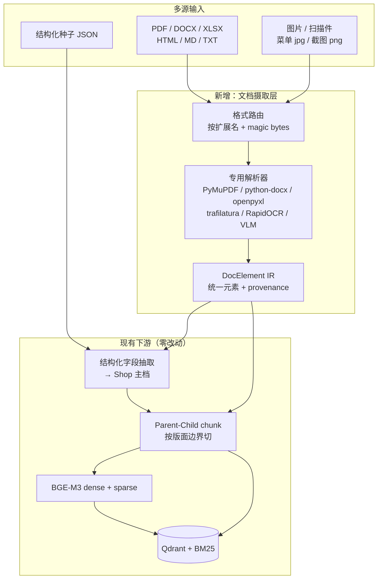

# 01 文档摄取与多模态向量化｜方案增补 v1.0

> 对应主文档 `00-方案规划.md` v1.1。
> 回答的问题：数据源不能只有"生成的 JSON"，那不同格式文档（PDF / TXT / MD / XLS / DOC / HTML / 图片）怎么进 RAG？多模态向量化到底做不做、怎么做？

---

## 0. 先把概念拆开：你问的其实是两层

| 层 | 定义 | 典型对象 | 核心技术 |
|---|---|---|---|
| **多格式解析（Multi-format ingestion）** | 把不同**容器格式**解码成统一文本 + 结构 + 来源坐标 | PDF、DOCX、XLSX、HTML、MD、TXT、CSV | 格式解析器、版面还原、表格结构化、标题层级 |
| **多模态（Multimodal）** | 数据本身**跨模态**，文字之外还有图像/版式/表格视觉信息 | 图片菜单、扫描 PDF、点评截图、菜品照片、复杂表格 | OCR、VLM caption、图像 embedding、跨模态对齐、late interaction |

两者关系：**多格式是入口问题，多模态是内容问题**。一份纯文本 PDF 只是"多格式"；一份扫描版菜单 PDF 既是多格式也是多模态；一张 jpg 菜单是纯多模态、没有格式解析问题。

### 为什么 v1.0 里没有这层（不是遗漏，是范围收敛）

v1.0 的数据源是合成 JSON，走的是：

```
结构化记录 → 半结构化文本渲染 → BGE-M3 向量化
```

这叫 **record-level / structured RAG**。它的取舍是：用"数据已经结构化"换掉整个解析层，好把精力集中在硬约束 pre-filter、混合检索、RRF、Rerank、评估这些**检索核心链路**上。工程上完全成立，先跑通再扩容也是对的。

**但对"面试学习"这个目标，代价很大**：企业里做 RAG，真正花时间的往往不是调 embedding，而是把一堆脏 PDF / Excel / 网页弄成可检索的干净数据。行业里常说解析层占落地工作量的大头，且**解析质量就是 RAG 效果的上限**——解析丢了表格行列关系，后面换什么模型都救不回来。所以这一层必须补，而且比"再换一个 embedding 模型"更值得投入。

### 补，但不无脑补

无 GPU 是硬约束，所以要分两级：

| 级别 | 内容 | 结论 |
|---|---|---|
| **1b-A 多格式文本摄取** | PDF/DOCX/XLSX/HTML/MD/TXT → 统一 DocElement IR → 接现有 chunk 链路 | **必做**，纯 CPU、依赖轻、覆盖 80% 面试考点 |
| **1b-B 图片与多模态** | 扫描件 OCR + 图片菜单 VLM caption（文本化）；图像 embedding / ColPali 只做原理与对照 | **A 做完再定**，OCR+caption 落地，重模型不落地 |

明确一条原则：**不要为了炫技把需要 GPU 的 ColPali 塞进项目**。能在白板上讲清它和传统 OCR+parse 的取舍，比跑不起来强得多。

---

## 1. 广州美食场景里真实存在的多格式 / 多模态语料

| 语料 | 格式 | 内容 | 抽取目标 | 难点 |
|---|---|---|---|---|
| 店铺清单 | `xlsx` / `csv` | 300 家店：区域、人均、菜系、忌口标签 | 直接映射 `Shop` 主档 | 合并单元格、多级表头、数字被存成文本 |
| 餐厅菜单 | `pdf`（文本层）/ `jpg` | 菜名、价格、辣度、配料 | 菜品级 Child + 过敏原 | 双栏排版、图片菜单无文字层 |
| 榜单/指南 | `pdf`（扫描或排版复杂） | 必吃榜、老字号名录 | 榜单标签 + 店名 | 扫描件需 OCR；表格跨页 |
| 探店攻略 | `html` | "西华路 10 家肠粉" 列表型文章 | 店名 + 评价 + 场景 | 广告/导航/相关推荐噪声、列表项要按条目切 |
| 个人笔记 | `md` / `txt` | 自己整理的口味偏好、踩雷记录 | 软偏好 / cons 来源 | 标题层级是天然边界，别按字数硬切 |
| 探店报告 | `docx` | 带标题、表格、插图的长文 | 段落 + 表格 + 图注 | 图片与正文的关联、标题层级 |
| 点评/招牌截图 | `png` / `jpg` | 菜单照片、排队照片、招牌 | 菜名、价格、环境氛围 | 无文字层，必须 OCR + VLM |
| 老字号介绍 | 扫描 `pdf` | 竖排/繁体/老照片 | 年份、历史、氛围 | OCR 中文准确率、竖排 |

> 注意：这些语料和 v1.0 的合成 JSON **不冲突**，而是两条输入通道，最终都汇到同一个 `Shop` / `Chunk` 模型。合成数据负责"字段齐全、可控、便于评估"，真实格式文档负责"链路完整、可迁移到生产"。

---

## 2. 补齐后的离线链路



**架构上唯一重要的决定**：新增层只负责产出**统一的 `DocElement` 中间表示**，下游的 `Shop` schema、Parent-Child、BGE-M3、Qdrant、在线查询链路**一律不改**。加一层适配而不是改全链路，是这层能做"可插拔"的关键，也是面试里能讲出的设计感。

---

## 3. 统一中间表示：DocElement（这层的核心产出）

```python
from pydantic import BaseModel
from typing import Literal

class DocElement(BaseModel):
    doc_id: str                       # 稳定 ID = sha256(文件绝对路径)[:16]
    source_uri: str                   # 原始文件绝对路径 / URL（原件只读，永不修改）
    source_type: Literal[
        "pdf", "docx", "xlsx", "csv", "html", "md", "txt", "image"
    ]
    element_type: Literal[
        "title", "paragraph", "table", "table_row",
        "list_item", "image", "ocr_text", "caption"
    ]
    text: str                         # 归一化后的文本（UTF-8、去多余空白）
    table: list[list[str]] | None = None   # 表格二维结构，绝不 flatten
    bbox: tuple[float, float, float, float] | None = None  # 版面坐标 x0,y0,x1,y1
    page_no: int | None = None
    sheet_name: str | None = None
    row_no: int | None = None
    image_ref: str | None = None      # 抽出的图片落盘路径
    ocr_conf: float | None = None     # OCR 置信度，低于阈值进人工队列
    provenance: str                   # 人可读来源："p3 / 表2 / 第5行"
    parse_version: str                # "ingest@1.0 / pymupdf@1.24"
    content_hash: str                 # 元素级 hash，用于增量跳过
```

示例（Excel 店铺清单的一行）：

```json
{
  "doc_id": "a3f9c21e...",
  "source_uri": "data/raw_docs/gz_shops.xlsx",
  "source_type": "xlsx",
  "element_type": "table_row",
  "text": "【店名】穗香居·西华路肠粉｜【区域】荔湾区｜【人均】18｜【菜系】粤菜",
  "table": [["店名", "区域", "人均", "菜系"], ["穗香居·西华路肠粉", "荔湾区", "18", "粤菜"]],
  "sheet_name": "店铺清单",
  "row_no": 42,
  "provenance": "店铺清单!第42行",
  "parse_version": "ingest@1.0/openpyxl@3.1",
  "content_hash": "9d1c..."
}
```

### 为什么 `provenance` 是这层的命门

单格式 RAG 的引用写 `shop_id` 就够了；多格式 RAG 的答案必须能回溯到**第几页 / 哪个 sheet 第几行 / 哪张图**，否则无法人工核验。实现上把 `provenance` 一起写进 Qdrant payload，生成答案时作为引用渲染出来：

> 「穗香居人均 ¥18（来源：`gz_shops.xlsx` → 店铺清单!第42行）」
> 「鲜虾肠粉 ¥12，含虾（来源：`menu.pdf` → p3 / 菜品表 / 第5行）」

这也直接强化 v1.0 的防幻觉校验器：引用不仅要 ∈ 召回集，还要能定位到原始文件的具体位置。

---

## 4. 格式 → 解析器选型（逐个说为什么）

| 格式 | 主选 | 备选 | 为什么选它 | 主要坑 |
|---|---|---|---|---|
| PDF（有文字层） | **PyMuPDF (fitz)** | pdfplumber / pypdf | C 扩展、快、纯 wheel 无编译；`page.get_text("dict")` 能拿到 **block 级坐标、字体、字号**，可据此还原标题层级和双栏阅读顺序；直接给 `page_no` | 双栏 PDF 默认按绘制顺序输出会串行 → 需按 bbox 的 x/y 排序 |
| PDF（表格） | **pdfplumber `extract_tables()`** | camelot / Table Transformer | 保住二维行列结构，返回 `list[list[str]]`，正好灌进 `DocElement.table` | 跨页表要合并；无框线表会漏；Table Transformer 需 GPU，不用 |
| PDF（扫描/图片） | **RapidOCR (ONNXRuntime)** | PaddleOCR / Tesseract chi_sim | 中文识别率高、**ONNX 在 CPU 上就能跑**、依赖比 PaddleOCR 轻很多，适配本机无 GPU | PaddleOCR 中文更强但要装 paddle 全家桶（重）；Tesseract 中文明显差 |
| DOCX | **python-docx** | mammoth / MarkItDown | 能读 `paragraph.style`（Heading 1/2 → 天然 chunk 边界）、`tables`、图片关系（`document.part.rels`） | 老 `.doc` 是二进制，先用 `soffice --headless --convert-to docx` 转 |
| XLSX / CSV | **openpyxl + pandas** | — | 能拿 `sheet_name` + `row_no`，直接产出 provenance；单元格类型明确（数字不会被当字符串） | 合并单元格要前向填充；多级表头要显式展平；CSV 注意 GBK 编码 |
| HTML | **trafilatura** + BeautifulSoup 兜底 | readability / MarkItDown | trafilatura 专门做正文抽取，自动去导航/广告/相关推荐，保留标题与列表结构；BS4 用来抓 `<li>` / `<h2>` 做条目级切分 | 列表型攻略（"10 家肠粉"）必须按条目切，整页塞一个 chunk 会稀释 |
| MD / TXT | 直接读 + 按标题切 | — | `#`/`##` 层级就是天然语义边界，无需模型 | 无标题的纯 TXT 才退回按段落 + 滑窗 |
| 图片 | **RapidOCR + 云 VLM caption** | 本地 CLIP / BGE-VL | 无 GPU 下本地图像编码慢；OCR 出事实、VLM 出语义描述，两者都变成文本进现有索引 | caption 会幻觉，必须和 OCR 原文分开存 |
| 全格式兜底 | **MarkItDown**（微软） | — | 一个库把 PDF/DOCX/XLSX/PPTX/HTML/图片/音频统一转 Markdown，**适合一天内打通全格式演示** | 为了通用会**丢版面坐标和页码**，provenance 不足 → 只做兜底与对照，不作主链路 |
| 企业级对照 | **Unstructured `partition_*`** | LlamaParse（云） | 输出 Title / NarrativeText / Table / Image 等 **element 级** JSON，天然适合按元素切 chunk；是生产常见形态 | 依赖多、CPU 慢、部分策略要下模型；LlamaParse 要钱要网络 → 起步不选，但**必须知道它存在** |

**选型主线（面试一句话）**：专用解析器保住**结构与坐标**，统一 IR 屏蔽格式差异；MarkItDown / Unstructured 是"快但丢信息"和"全但重"的两端，主链路取中间。

### Parser 接口（保证可插拔）

```python
class Parser(Protocol):
    source_types: set[str]
    def parse(self, path: Path) -> list[DocElement]: ...

class IngestPipeline:
    def __init__(self):
        self._parsers: dict[str, Parser] = {}
    def register(self, parser: Parser) -> None: ...
    def run(self, root: Path) -> Iterator[DocElement]:
        for p in root.rglob("*"):
            key = sniff(p)                      # 扩展名 + magic bytes，防错扩展名
            yield from self._parsers[key].parse(p)
```

新增格式 = 新增一个 Parser 实现并注册，主链路零改动。

---

## 5. 真正的多模态难点：表格与图片

### 5.1 表格为什么不能 flatten 成文本

把

| 菜名 | 价格 | 含花生 |
|---|---|---|
| 鲜虾肠粉 | 12 | 否 |
| 沙嗲牛肉 | 28 | 是 |

flatten 成 `"菜名 价格 含花生 鲜虾肠粉 12 否 沙嗲牛肉 28 是"`，行列对应关系就丢了：用户问「哪道菜含花生」，embedding 只能给出模糊相似，无法可靠回答；更糟的是**过敏原是硬约束**，模糊匹配在这里等于安全事故。

**两种正确落法**：
1. **结构化入库（A 通道）**：表格 → `Shop` / `Dish` 字段，`contains_peanut: bool` 进 payload index，走 pre-filter。硬事实一律走这条路。
2. **行级字段化文本（B/C 通道）**：每行渲染成带字段名的短文本再编码，例如
   `【菜品】沙嗲牛肉｜【价格】¥28｜【含花生】是｜【来源】menu.pdf p3 表2 第5行`
   这样语义检索也能保住字段边界。

> 规则：**表格的"事实"进结构化通道，表格的"描述"进语义通道**，两者都保留，而不是二选一。

### 5.2 图片的三条路线（按成本与本机可行性排序）

| 路线 | 做法 | 是否落地 | 优点 | 代价 / 陷阱 |
|---|---|---|---|---|
| **① OCR + VLM caption → 文本化** | RapidOCR 抽文字 + 云 VLM（Qwen-VL / GPT-4o-mini 视觉）生成 1~2 句描述，两者都作为文本 chunk 进 BGE-M3 | ✅ **主选** | 不改检索架构、不需要图像 embedding、可解释、可回溯 OCR 原文；无 GPU 完全可行 | 丢失视觉相似度，无法"以图搜图"；caption 会幻觉 |
| **② 图像 embedding 双路索引** | CLIP / BGE-VL / jina-clip 把图片编码成向量，建**独立 collection**，召回后在 RRF 层与文本路融合 | ⚠️ 认知 + 可选小样 | 支持"以图搜图"、菜品照片相似检索 | **文本向量和图像向量若不是同一对齐模型输出，绝不能放同一个 collection 算 cosine**——这是面试高频陷阱；且本地编码需算力 |
| **③ ColPali / ColQwen 页面截图多向量** | 整页渲染成图 → 切 patch → VLM 出 patch 级向量 → late interaction（MaxSim）打分，端到端保留版面 | ❌ **只讲原理，不落地** | 省掉整条解析链，版面/表格/图片一网打尽，效果最好 | 需要 GPU，本机不可行；索引体积大 |

**路线 ① 的防幻觉设计**（很重要）：
- `ocr_text` 与 `caption` **分成两个 DocElement**，各自标注 `element_type`；
- 事实性字段（价格、菜名、过敏原）**只从 OCR / 结构化字段取**，禁止用 caption 填硬约束；
- caption 只用于 C 通道语义召回（"这家看起来很有烟火气"）；
- `ocr_conf < 0.75` 的元素打 `needs_review`，不进硬约束字段，进人工复核队列。

**图文关联**：图片元素与相邻文字元素建立 `nearby_ids`，召回命中任一方的 Parent 时把关联元素一起送进 LLM 上下文，避免"召回了一张菜单图却没有店名"。

---

## 6. 对现有架构的影响清单

| 部分 | 是否改动 | 说明 |
|---|---|---|
| 在线查询链路 | ❌ 不改 | 槽位解析 / pre-filter / 三路召回 / RRF / Rerank / 复核 / 生成 全部保持 |
| `Shop` / `Chunk` schema | 🔸 小改 | `Chunk` 增加 `provenance`、`source_type`、`nearby_ids`；`Shop` 增加 `source_docs: list[str]` |
| Parent-Child 策略 | 🔸 小改 | 保持父子结构，但 **chunk 边界改为优先对齐版面边界**：标题层级 / 页 / 表格行 / 列表项，禁止跨页跨表硬切 |
| BGE-M3 / Qdrant / BM25 | ❌ 不改 | 新增的 `provenance` 只是 payload 字段 |
| 引用格式 | 🔸 小改 | 从 `shop_id` 扩展为 `shop_id + provenance`（页码 / sheet 行号 / 图片路径） |
| 防幻觉校验器 | 🔸 小改 | 引用校验增加"provenance 必须存在于解析产物"这一条 |
| 索引 | 🔸 可选 | 路线 ② 才需要独立 image collection；路线 ① 不需要 |

### 新增模块

```
src/gz_rag/ingest/
├── base.py          # Parser Protocol + DocElement
├── sniff.py         # 扩展名 + magic bytes 识别
├── pdf_text.py      # PyMuPDF（block 坐标 → 阅读顺序）
├── pdf_table.py     # pdfplumber 表格 → table_row
├── pdf_scan.py      # RapidOCR（ONNX CPU）
├── office.py        # python-docx / openpyxl / pandas
├── web.py           # trafilatura + BeautifulSoup
├── plain.py         # md / txt 标题切片
├── image.py         # OCR + 云 VLM caption（走 LLMClient 抽象）
├── normalize.py     # 清洗、去重、provenance 生成、content_hash
├── pipeline.py      # 目录扫描 / 增量 / dead_letter
└── markitdown_fallback.py   # 对照实验用

data/raw_docs/       # 原始多格式文档（只读，不改动原件）
data/parsed/         # DocElement IR jsonl
data/images/         # 从 PDF/DOCX/HTML 抽出的图片
data/dead_letter/    # 解析失败记录
```

### 增量解析（和索引层的增量是两套）

- 文件级：`sha256(文件内容) + parse_version` 未变 → 跳过；变了 → 重解析该文件，按 `doc_id` 删除旧元素再写入。
- 元素级：`content_hash` 未变 → 不重新 embedding（省 CPU）。
- 失败隔离：单文件解析失败写 `data/dead_letter/`，**不阻塞整批**；记录异常类型与堆栈。
- 解析版本升级（例如换 OCR 引擎）→ 全量重跑摄取，但**索引层可只更新变化的元素**。

---

## 7. 依赖与成本（无 GPU 约束下的现实清单）

```txt
# 追加到 requirements.txt
pymupdf>=1.24           # PDF 文本层 + 版面坐标
pdfplumber              # PDF 表格
rapidocr-onnxruntime    # 中文 OCR，CPU 可跑
python-docx             # DOCX
openpyxl                # XLSX
pandas                  # 表格处理
trafilatura             # HTML 正文抽取
beautifulsoup4          # HTML 结构兜底
python-magic-bin        # Windows 下 magic bytes 识别（或自写文件头判断）
markitdown              # 全格式兜底 / 对照（可选）
Pillow                  # 图片落盘与尺寸处理
```

**成本判断**：
- 全部解析库纯 CPU，0 元；`torch` 仍用 CPU 版（OCR 走 ONNXRuntime，不依赖 torch）。
- 云 VLM：只对**图片类语料**调用，规模约几十到几百张，一次 caption 几百 token，成本可忽略；且可先用规则模板 / 无 caption 跑通 A 阶段再补。
- **明确不做的**：PaddleOCR 全家桶、Table Transformer、CLIP 本地编码、ColPali——都需要额外算力或 GPU，本机不具备，写进文档作为"知道但不选"的选型论证即可。

---

## 8. 评估补充

### 解析层独立指标（v1.0 没有，必须补）

| 指标 | 定义 | 及格线 |
|---|---|---|
| 文本还原率 | 解析文本 vs 原文人工核对的字符一致率 | ≥ 98% |
| 表格行列准确率 | 抽出的二维结构与原件一致的比例 | ≥ 95% |
| OCR 字准 | 扫描件文字识别准确率（抽样 20 页） | ≥ 90%（低置信进人工队列） |
| provenance 可回溯率 | 随机抽 50 条答案引用，能定位到原文件具体位置 | **100%** |
| 解析失败率 | 进 dead_letter 的文件占比 | < 2% |

### golden set 新增 4 类 query

1. **Excel 行级事实**："店铺清单里荔湾区人均低于 20 的有几家" → 考察表格结构化是否正确
2. **PDF 菜单菜品**："哪家菜单上有不含花生的肠粉" → 考察表格 + 硬约束交叉
3. **HTML 攻略条目**："那篇西华路攻略里被夸镬气足的是哪一家" → 考察列表项切分
4. **图片菜单 OCR**："图片菜单里 15 块以下的点心有哪些" → 考察 OCR 与价格数值化

### 新增消融组

| 配置 | 观察指标 | 预期结论（待实测） |
|---|---|---|
| 表格 flatten vs 表格结构化 | 表格类 query 的 Recall@10 | 结构化显著更高 |
| 无 OCR vs 有 OCR | 图片类 query 召回率 | 无 OCR 时接近 0 |
| caption 参与硬约束 vs 只用 OCR | 硬约束满足率 | caption 参与会破坏 100% 红线 |
| 固定 512 切分 vs 版面边界切分 | faithfulness | 版面切分更高 |

---

## 9. 面试考点（本层新增，接主文档 20 问之后）

21. **为什么说解析层是 RAG 效果的上限？** — 信息在解析阶段丢失后不可逆；换 embedding / 换 LLM 都补不回表格行列关系。
22. **表格为什么不能 flatten 成一串文字？** — 行列对应关系丢失，且过敏原/价格这类硬事实无法做结构化过滤。
23. **为什么必须保留 bbox / 页码 / sheet 行号？** — 阅读顺序还原（双栏）、引用可回溯、增量更新定位。
24. **文本向量和图像向量能放同一个索引算 cosine 吗？** — 只有在同一个对齐过的多模态模型、同一向量空间输出时才可以；否则必须独立 collection + 在 RRF 层融合（分数不可比）。
25. **ColPali 和传统 OCR+parse 的取舍？** — ColPali 端到端保版面、省解析链，但需 GPU、索引体积大、可解释性差；传统链路可审计、可增量、CPU 可跑。
26. **VLM caption 为什么不能用来填硬约束？** — caption 是生成式描述会幻觉；事实只能来自 OCR 原文或结构化单元格。
27. **扫描 PDF 和文本层 PDF 怎么自动分流？** — 先取 `page.get_text()`，文本字符数低于阈值判定为扫描件 → 转 OCR 分支。
28. **解析失败怎么处理才不拖垮整批？** — dead letter 隔离 + 单文件 sha256 增量 + 元素级 hash 避免重复 embedding。
29. **双栏 / 竖排 PDF 为什么容易串行？** — PDF 存的是绘制顺序不是阅读顺序；要按 bbox 聚类成栏再排序。
30. **什么时候不该上多模态？** — 语料以文字为主、无"以图搜图"需求、无 GPU 预算时，OCR+caption 文本化的收益/成本比最高。

---

## 10. 落地拆分（接主文档 Phase 1）

| 子阶段 | 目标 | 产出 | 验收标准 |
|---|---|---|---|
| **1a**（原 Phase 1） | 合成种子数据 + chunker | 300 家 JSON、reviews、自定义词典 | Pydantic 100% 通过、chunk 2000± |
| **1b-A** 多格式文本摄取（必做） | 6 类格式文档 → DocElement IR → 接入现有 chunk | `ingest/` 模块 + `data/parsed/*.jsonl` + 一批真实格式的样例语料（每种 2~3 份） | 6 类格式全部解析成功；provenance 可回溯率 100%；表格行列准确率 ≥ 95%；下游索引链路**零改动**跑通 |
| **1b-B** 图片与多模态（可选） | OCR + VLM caption 文本化；图像 embedding 仅做原理对照样例 | `image.py` + 图片语料 + 2 组消融 | OCR 字准 ≥ 90%；caption 不参与硬约束；新增 4 类 golden query 通过 |

**推进顺序**：1a → 1b-A →（确认收益后再决定）1b-B → Phase 2。1b-A 做完，项目就从"玩具数据集 RAG"升级成"能接真实脏文档的企业级 RAG 链路"，这一步对面试的价值最高。

---

## 与主文档的对应关系

| 主文档位置 | 本次修订 |
|---|---|
| 标题 / 定位 | v1.0 → v1.1，声明增补文档摄取层 |
| §2 总体架构 mermaid | 离线链路前置「多源输入 → 格式路由 → 解析器 → DocElement IR」 |
| §3.1 数据来源 | 单通道（合成 JSON）→ **双通道**（合成 JSON + 多格式文档语料） |
| §4.0 选型总表 | 新增「文档解析 / OCR / 多模态」两行 |
| §4.8 | 新增小节，指向本文件 |
| §5 目录树 | 新增 `ingest/`、`raw_docs/`、`parsed/`、`images/`、`dead_letter/` 与本文件 |
| §6 Phase 1 | 拆为 1a / 1b-A / 1b-B |
| §7 坑表 | 新增 5 条解析层坑 |
| §9 依赖 | 追加解析依赖清单索引 |
