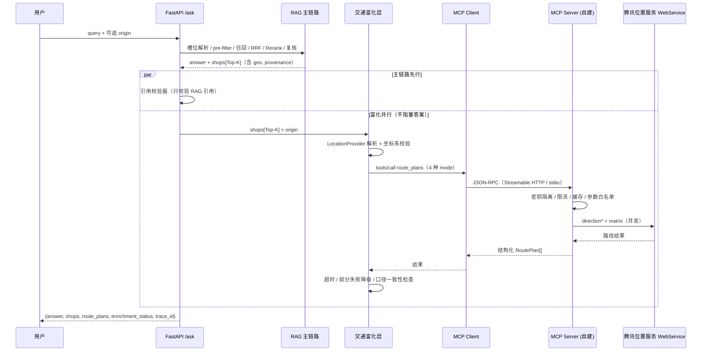

# 02 实时交通富化与 MCP 集成｜可行性与方案评估 v1.1

> 对应主文档 `00-方案规划.md` v1.3。
> 回答的问题：RAG 检索出 Top-K 餐厅后，默认获取当前位置，用 MCP / function calling 接地图服务，同步给出驾车 / 骑行 / 步行 / 公共交通四种方案（**公共交通需给出具体换乘方案**）——是否可行、是否加分、怎么做。
> **v1.1 变更（按用户需求确认）**：四档输出改为**分级粒度** —— `transit` 返回完整换乘明细（线路 / 上下车站 / 中间步行多久 / 票价 / 首末班），`driving / cycling / walking` **只返回参考耗时**；公共交通多方案默认取**用时最少**的一条。新增 `TransitLeg` 结构、`routes[]` 与 `lines[]` 两层区分、单位归一化、方案选择确定性规则、评估指标与 4 道面试追问。
> **用户既定边界：交通方案只用于筛选后的结果，不作为 RAG 检索条件。**

---

## 0. 结论速览

| 问题 | 结论 |
|---|---|
| 是否可行 | ✅ **可行**，且比预想省事：腾讯位置服务有官方 MCP Server，`directionDriving` / `directionBicycling` / `directionWalking` / `directionTransit` 四种路径规划 + `matrix` 距离矩阵 + `ipLocation` 定位齐备 |
| 是否加分 | ✅ **加分，但加的不是 RAG 的分**，而是 ① Agent / Tool-use 与 MCP 协议 ② 实时外部数据与检索解耦的系统设计 ③ 地图合规与密钥安全。它**不会**提升 Recall@10 / NDCG，反而可能污染评估基线 |
| 你的边界判断 | ✅ **完全正确**，而且建议再往前一步：不仅不进检索，**也不进 LLM 的事实生成**，只做结构化字段拼接 |
| 倾向 MCP | ✅ 判断对，但要纠正一个认知：**FC 与 MCP 不是二选一**，MCP 是工具供给层，模型侧仍是 function calling；且本需求更适合**确定性编排**而非让 LLM 自主决定调不调工具 |
| **四档输出粒度**（v1.1 确认） | **不同粒度**：`transit` → 完整换乘明细（线路 / 上下车站 / 换乘步行时长）；`driving / cycling / walking` → **仅参考耗时**。公交多条方案 → 默认只给**用时最少**的一条 |
| 工作量 | 约 **+1 个 Phase**，建议排在主链路跑通、评估基线建立**之后**（Phase 5.5），不要在一开始引入 |
| 三个硬前提 | ① 合规数据源（境内持牌服务商，默认腾讯位置服务）② API key 只放服务端环境变量 ③ 全链路失败可降级，RAG 答案必须照常返回 |

---

## 1. 边界：为什么实时数据绝不能进检索

你划的这条线是整个设计里最专业的部分。补上完整论证，面试时能直接讲：

| 理由 | 说明 |
|---|---|
| **时效性** | 路况分钟级变化，索引里的"耗时"从写入那一刻起就在过期；重建索引的成本与收益完全不成比例 |
| **维度爆炸** | 耗时是 `f(起点, 终点, 方式, 出发时刻)` 的函数，起点是连续空间，无法枚举成可索引的字段 |
| **成本** | Top-K 之外的全量店铺算路线毫无意义；离线全量预计算 = 几万次 API 调用 |
| **可复现性** | golden set 的 Recall@10 / NDCG 依赖确定性结果；一旦掺入实时数据，消融实验和回归测试全部失效 |
| **缓存与增量** | 实时结果无法进"按内容 hash 增量更新"的体系，会破坏 §6 的增量解析设计 |
| **合规** | 精确位置属于个人信息，不应落库；批量存储他人/用户位置数据有 PIPL 风险 |

### 架构红线（新增第 2 条，与 v1.0 的硬约束红线并列）

> **红线 1**：忌口 / 预算 / 区域 / 距离等硬约束 → pre-filter + 后置复核，满足率 100%。
> **红线 2**：实时外部数据（交通耗时、天气、排队）→ **只做 post-retrieval enrichment**：
> 不进向量库、不进 payload filter、不参与 RRF / Rerank 打分、不写回任何索引、不改变 Top-K 集合与顺序。

### 建议再往前一步：也不进 LLM 的事实生成

| 方案 | 做法 | 评价 |
|---|---|---|
| A. 生成前注入 | 把四种耗时拼进 prompt，让 LLM 组织成自然语言 | ❌ 延迟直接进主链路 P95；LLM 可能把耗时当推荐理由、甚至编造数字；后置校验器只校验 `shop_id`，校验不到交通数值 |
| **B. 生成后结构化拼接（推荐）** | RAG 主链路先返回结构化答案 + 店铺卡片；交通富化并行执行，作为**独立的 `route_plans` 字段**由 API 层合并返回，LLM 完全不碰这些数字 | ✅ 零幻觉、零延迟耦合、可缓存、可降级、可复现；前端自行展示四列耗时 |
| C. 可选对照 | 开 `enrich_then_summarize` 开关，把交通摘要交给 LLM 生成一句"最快到达"的话，但数字必须从工具返回值模板填充并做数值一致性校验 | ⚠️ 仅作为对照实验 / 面试演示，不进默认链路 |

默认 **B**。这样"交通方案只用于筛选后的结果"被贯彻得更彻底：既不影响检索，也不影响生成。

```
POST /ask
  ├─ RAG 主链路（槽位 → pre-filter → 三路召回 → RRF → Rerank → 复核 → LLM 生成 → 引用校验）
  │     └─ 产出 answer + shops[Top-K]（含 geo / provenance）
  └─ [并行] 交通富化（定位 → MCP tools/call → 四档方案 → 缓存 → 降级）
        ├─ driving / cycling / walking → {duration_sec}                  # 仅参考耗时
        └─ transit → {duration_sec, legs[], 换乘步行/总步行/票价/首末班}  # 完整方案，默认取用时最少
      ↓
  API 层合并：{answer, shops, route_plans, enrichment_status, trace_id}
```

### 1.1 四档输出分级（v1.1 用户确认）

| mode | 对外输出 | 是否返回明细 | 理由 |
|---|---|---|---|
| `driving` / `cycling` / `walking` | `duration_sec`（参考耗时） | ❌ 不返回 `steps` / `polyline` / 路径点串 | 用户只需"大概多久"；明细会放大 payload 与解析成本，还会引入路线坐标数据 |
| `transit` | `duration_sec` + `legs[]` 分段换乘明细 + 汇总量 | ✅ 线路名、上下车站、站数、每段耗时、**中间步行多久**、票价、首末班 | 公交/地铁方案**没有明细就没有信息量**：只知道"38 分钟"无法判断要换乘几次、要走多久 |

> `distance_m` 作为**内部字段**保留，用于 §7 的口径一致性校验（直线距离 vs 路线里程）；API 层可选择不暴露，它不属于"方案明细"。这一分级不违反架构红线 2：粒度差异仍只发生在 post-retrieval 的结构化字段里，LLM 与 RAG 主链路完全不感知。

---

## 2. 合规先行：这一关必须先过

涉及地图与路径规划，以下为**强制红线**，不是建议：

| 项 | 规则 | 本项目落地 |
|---|---|---|
| **数据源白名单** | 仅允许**腾讯地图、高德地图、百度地图、天地图**；禁止 Google Maps / Apple Maps / Bing 海外版 / Mapbox / Leaflet+OSM / 境外瓦片 / 无资质第三方 | 用户未指定厂商 → **默认腾讯位置服务**；`MapProvider` 适配层保留高德/百度可换 |
| **横评里的坑** | 2026 年不少"地图 MCP 横评"把 Mapbox 列进来并夸其 Matrix / Isochrone 能力 | ❌ **不可因为"横评里有"就采用**：Mapbox 不在合规白名单，且不支持国内地图数据、无公交路径规划，对本场景双重不合格 |
| **坐标系** | 境内统一 **GCJ-02**（火星坐标）；百度为 BD-09，天地图为 CGCS2000 | 店铺 `geo` 字段、pre-filter 的 `geo_radius`、路线起终点**必须同一坐标系**；浏览器 GPS 的 WGS-84 必须转换后再调用，否则偏移数百米 |
| **密钥** | 绝不能内嵌 / 预置 / 夹带任何有效地图 API key；不得产出带可用 key 的完整代码 | 本项目是**独立部署的 Python 服务**，不是 WorkBuddy 内嵌页面 → 前端 GL JS 的 `_TMapSecurityConfig` 代理模式不适用，属于**非默认场景**：需自行申请 key，经**服务端环境变量**注入 |
| **key 申请入口** | 腾讯位置服务开放平台（`lbs.qq.com`）→ 控制台创建应用 → 添加 Key 时勾选 **WebServiceAPI**（路线规划 / 距离矩阵 / IP 定位 / 地址解析都是它下面的接口族，**不是三个独立开关**）→ 配置 IP 白名单 → 查看调用配额 | 配置里写显式占位符，**真实 key 只存环境变量，绝不进仓库、日志、LLM 上下文、前端**；控制台逐步操作与自检见 `docs/13` |
| **服务端防护** | 后端代理鉴权；Streamable HTTP 必须校验 `Origin` 头防 DNS rebinding；本地服务只绑 `127.0.0.1` | MCP Server 统一实现；商业场景必须后端代理，不能把 key 放前端 |
| **个人信息** | 不得收集 / 存储 / 公开他人位置数据；个人坐标仅本地私有存储 | 用户位置只在**会话内存**，不落库、不写日志；IP 定位仅取城市级；提供"不授权定位"的手动输入路径 |
| **本需求不渲染地图**（v1.1 修订） | **不画地图、不画路线、不落坐标点串**；但 v1.1 起公共交通需返回**文本化换乘明细**（线路名 / 站名 / 时长 / 步行距离），这些是结构化文本，不是地图渲染 | 仍不引入 GL JS / 瓦片，合规面不变；`polyline` / `bounds` / 站点 `location` 一律在 Provider 适配层丢弃，不外发、不落库。若后续加可视化页，再按默认代理模式（SDK URL 不带 key）处理 |

> 面试加分点：能主动说出"Mapbox 在这类横评里很亮眼但境内不合规"，比只会调 API 高一个层次。

---

## 3. 可行性盘点：官方 MCP 能力（2026-11 查证）

腾讯位置服务官方 MCP Server（托管式，基于 MCP 协议封装 WebService API）工具集：

| 工具 | 底层接口 | 本项目用途 |
|---|---|---|
| `directionDriving` | `/ws/direction/v1/driving` | 驾车耗时、距离、收费、路况偏好 |
| `directionBicycling` | `/ws/direction/v1/bicycling` | 骑行耗时、距离 |
| `directionWalking` | `/ws/direction/v1/walking` | 步行耗时、距离 |
| `directionTransit` | `/ws/direction/v1/transit` | **v1.1 主用途**：`routes[]` 多方案 + `steps[]` = [步行, 公交, 步行, 公交, 步行]，含线路名、上下车站、站数、每段耗时、换乘步行时长、票价、首末班 |
| `matrix` | `/ws/distance/v1/matrix?mode=driving\|walking` | **批量**算多目的地距离/耗时 |
| `ipLocation` | IP 定位 | 默认位置兜底（**城市级**） |
| `geocoder` / `reverseGeocoder` | 地址 ↔ 坐标 | 用户输"体育西路"时的坐标解析 |
| `placeSearchNearby` / `placeDetail` | 周边 POI / 详情 | 可选：补充店铺 POI 校验 |
| `placeAlongby` / `waypointOrder` / `futureDrivingDirection` | 沿途搜索 / 途经点排序 / 未来路况 | 进阶玩法，本项目不作主链路 |

**厂商对比（均需以官方最新文档与配额为准）**：

| 厂商 | 工具数 | 四种路径 | 批量矩阵 | 部署形态 | 合规 |
|---|---|---|---|---|---|
| **腾讯位置服务** | ~15 | ✅ 全 | 驾车 / 步行 | SSE + Streamable HTTP，云端托管 | ✅ 默认 |
| 高德地图 | ~12 | ✅ 全 | 有 | Streamable HTTP 推荐，云端托管 | ✅ 可换 |
| 百度地图 | ~10 | ✅ 全 | 有 | 本地 npx / Python 部署 | ✅ 可换（注意 BD-09） |
| Mapbox | 10+ | ❌ 无公交 | 有 | stdio / Streamable HTTP | ❌ **禁用** |

**结论**：四种方案全部有现成能力，可行性无疑问。但有两个工程细节必须提前知道：
1. `matrix` 只覆盖**驾车 / 步行**，骑行与公交通常要逐目的地调用 → 调用量不能按"4 次批量"乐观估计（见 §9）。
2. 公交返回结构最复杂（换乘、票价、首末班），且受出发时刻影响最大 → 它通常是最慢、最易失败的一路，必须允许 `available: false`。
3. **单位不统一**：官方 `duration` 是**分钟**、`price` 是**分**（含 `RAIL` 方案时为元，可用 `price_unit=1` 统一成"分"）、`distance` 是米 → 必须在 Provider 适配层归一化成 `duration_sec` / `fare_yuan` / `distance_m`，绝不让上层看到原始单位（见 §8.3）。
4. **两层"多条"要分清**：`result.routes[]` 是整条行程的多个备选方案，`steps[].lines[]` 是**同一个乘车段里**多条可替换线路（同站点可坐 A 线或 B 线，官方说明 `lines[0]` 信息最完整）。用户说的"多条线路默认取用时最少"对应 **`routes[]` 层**（见 §8.3）。
5. `policy` 支持 `LEAST_TIME`（**时间短，接口默认**）/ `LEAST_TRANSFER` / `LEAST_WALKING` / `RECOMMEND`，可叠加 `NO_SUBWAY` / `ONLY_SUBWAY` / `SUBWAY_FIRST`；`departure_time` 用 Unix 秒过滤非运营时段线路。

---

## 4. Function Calling vs MCP：不是二选一，是分层

| 维度 | Function Calling | MCP |
|---|---|---|
| 本质 | 模型输出结构化调用意图，宿主应用执行 | 开放协议（JSON-RPC 2.0），Client / Server 架构 |
| 作用层 | **模型 ↔ 宿主** | **宿主 ↔ 工具供给方** |
| 耦合 | 工具 schema 写死在应用代码里 | 工具与宿主解耦，一个 Server 可被多客户端复用 |
| 能力模型 | tools | **tools + resources + prompts**；`tools/list`、`tools/call`、订阅、sampling / elicitation |
| 知识点 | JSON Schema、参数校验、并行调用 | 协议握手与能力协商、传输层、生命周期、错误语义、权限边界、取消、Origin 校验、无状态化 |
| 面试深度 | 基础 | 能讲到协议演进与安全边界，明显更深 |

**关键纠正（很多人搞错）**：MCP Client 通过 `tools/list` 拿到工具描述后，**仍要把 schema 转换成 LLM 的 tool/function definitions 才能触发调用**。所以"用 MCP"≠"不用 function calling"，两者是**上下层协作**：

```
LLM（function calling，决定是否/如何调用）
  ↕ tool definitions
MCP Client（协议：initialize / tools:list / tools:call / 传输 / 错误）
  ↕ JSON-RPC over stdio | Streamable HTTP
MCP Server（暴露工具、隔离密钥、限流、缓存）
  ↕ HTTPS
地图 WebService API
```

**更关键的判断：本需求不需要让 LLM 决定调不调工具。**
你的描述是"检索到 Top-K 之后，同步给出四种方案"——这是一个**确定性编排**：触发条件固定（拿到 Top-K）、参数固定（起点 + K 个终点 + 4 种 mode）、顺序固定。交给 LLM 自主决策只会引入不确定性、额外一次 LLM 往返、以及"模型漏调某个工具"的失败模式，且无法写稳定的单元测试。

> **推荐**：代码层确定性调用 MCP Client，MCP 作为**工具供给与解耦层**；function calling 只在"可选对照实验"里演示（让 LLM 自主决定是否查天气/路况），不进主链路。
> 这反而是一个更好的面试回答：「我知道 Agentic tool choice 怎么写，但在这个场景我选确定性编排，因为……」——能讲出取舍比堆组件强。

---

## 5. 传输层选型：2026 年的现状（MCP 知识点集中地）

| 传输 | 适用 | 现状 |
|---|---|---|
| **stdio** | 学习期、本地单客户端、零网络 | ✅ 最简单，Windows 下注意子进程 UTF-8 编码与 stderr 不能污染 JSON-RPC |
| **Streamable HTTP** | 远程 / 生产、多客户端 | ✅ **推荐**。2025-03-26 引入，取代旧 HTTP+SSE |
| HTTP+SSE | 旧版云端 MCP | ⚠️ 已正式归类 **Deprecated**（SEP-2596，至少 12 个月移除窗口）；部分厂商官方 endpoint 仍是 `/sse` → 作为**兼容回退**，不要新写 |

**2026-07-28 规范修订要点（很能体现"你跟得上协议"）**：
- 协议趋于**无状态**：移除协议级会话与 `initialize` 握手；移除 GET 流端点，长生命周期通知改走 `subscriptions/listen` 响应流；
- Streamable HTTP 的 POST 必须带 `Mcp-Method` / `Mcp-Name` 请求头，便于网关 / 限流 / WAF 不解析包体就能路由与计量；
- 服务端**必须校验 `Origin` 头**（无效则 403），本地运行**只绑 `127.0.0.1`**，防 DNS rebinding；
- 客户端需处理新旧版本的向后兼容回退（POST 返回 400/404/405 时尝试旧传输）。

**落地策略**：自建 Server 用 MCP SDK 同时暴露 `stdio`（本地调试）与 `Streamable HTTP`（`/mcp`）；接官方托管 Server 时优先 Streamable HTTP endpoint，若官方仍提供 SSE 则登记为兼容回退并标注"待迁移"。**以官方文档实时形态为准，不把某个 URL 写死成事实。**

---

## 6. 默认获取当前位置：可落地性最大的坑

**纯后端 API 拿不到精确 GPS**。`ipLocation` 只能到**城市级**（几公里误差），用它算"步行 8 分钟"会错得离谱。这是必须先讲清的限制。

**`LocationProvider` 优先级链**：

| 优先级 | 来源 | 精度 | 前提 |
|---|---|---|---|
| 1 | 请求显式参数（`origin` / `business_area` / 地铁站） | 高 | 用户手输，最可靠、零授权 |
| 2 | 会话内上次位置（仅内存） | 高 | 不落库 |
| 3 | 客户端定位（浏览器 Geolocation / 小程序 `getLocation`） | 高 | **HTTPS + 用户明示授权**；返回多为 WGS-84，须转 GCJ-02 |
| 4 | `ipLocation`（MCP 工具） | 城市级 | 仅用于兜底/默认城市，**不用于算步行/骑行** |
| 5 | 要求用户选择商圈 | — | 无位置可用时的追问，不硬凑 |

**两个落地档位**：
- **档位 A（推荐先做，纯 API）**：位置从参数或商圈中心点来，零前端、零授权、零合规负担，能完整跑通 MCP + 四方案链路。
- **档位 B（可选，加一个轻量前端页）**：浏览器 Geolocation 拿 WGS-84 → 转 GCJ-02 → 传给后端；若同时展示地图，用腾讯地图 GL JS 的**默认代理模式**（SDK URL 不带 key，请求经 `_TMapSecurityConfig` 走本地代理），前端零 key 暴露。

> 面试讲点：「默认获取当前位置」听起来是产品需求，落到后端其实是**位置来源分级 + 坐标系统一 + 隐私授权**三件事，不是一行 `getLocation()`。

---

## 7. 架构与时序



**关键设计点**：
1. **富化与答案生成并行**，且答案不等待富化结果；`enrichment_status` 标注 `ok / partial / unavailable`，前端按状态渲染。
2. **口径一致性**：`geo_radius` 用的是球面直线距离，路线给的是道路里程，两者必然不等。答案里要显式区分「直线距离 X km（筛选用）」与「步行路线 Y km（实时）」，否则用户会看到"2 公里内却要走 5 公里"的矛盾。写一条校验：路线距离 < 直线距离 × 合理倍数上界，超出则标异常。
3. **不改 Top-K 顺序**。若产品想要"按最快到达排序"，那是**展示层重排**（前端或 API 的可选 `sort_by=arrival_time`），不改 RAG 的相关性分数、不写回索引。
4. **可观测**：`trace_id` 里记录每个 `tools/call` 的耗时、成功率、缓存命中、失败模式；这是排查"为什么公交那列经常空"的唯一依据。
5. **输出粒度分级**（v1.1）：只有 `transit` 带 `legs[]`，其余三档只有 `duration_sec`。合并层按 mode 做 schema 校验，防止把换乘明细误塞进驾车字段，也防止 `polyline` 泄漏到响应里。
6. **方案选择确定性**：公交最短路的选择发生在 MCP Server 内部，对同一 `(origin, shop_id, departure_time, policy)` 必须恒定；否则前端每次刷新方案会变，富化快照也无法复现。

---

## 8. MCP Server 设计：双轨，推荐自建

| 轨道 | 做法 | 价值 | 结论 |
|---|---|---|---|
| **A. 官方直连** | 直接配置腾讯位置服务官方 MCP Server（云端托管），应用内起 MCP Client 调用 | 一天跑通、零运维、验证需求可行性 | ✅ 先做，作为**对照与降级** |
| **B. 自建聚合 Server** | 自己实现 MCP Server，封装官方 WebService API，暴露面向本项目的聚合工具 | 协议层知识点全在这：传输、能力协商、错误语义、密钥隔离、限流、缓存 | ✅ **主选**（面试价值最高） |

推荐 **B 为主 + A 为对照**。A 用来快速验证"四种方案拿得到"，B 用来把知识点做实；两者通过同一个 `MapMcpClient` 接口切换，正好又是一次可讲的消融。

### 工具清单（自建，控制在 5 个以内）

| 工具 | 输入 | 输出 | 说明 |
|---|---|---|---|
| `resolve_location` | `address` 或 `ip` | `{lat, lon, coord, precision, source}` | 统一位置解析 + 坐标系标注；IP 结果标 `precision=city` |
| `route_plans` | `origin`, `destinations[]`, `modes[]`, `departure_time?`, `transit_policy=LEAST_TIME`, `transit_alternatives=0` | `RoutePlan[]`（联合类型） | **聚合工具**：一次调用内部并发 4 种 mode；`transit` 返回 `TransitRoutePlan`（含 `legs`），其余返回 `SimpleRoutePlan` |
| `route_matrix` | `origin`, `destinations[]`, `mode=driving\|walking` | `RoutePlan[]` | 走 `matrix` 批量接口，减少调用 |
| `poi_validate` | `shop_name`, `city`, `near` | `{poi_id, location}` | 可选：校验店铺 POI 与 `geo` 是否一致 |
| `health` | — | `{quota_left, latency_p95}` | 可观测 / 降级判断 |

`route_plans` 是自建的核心价值：官方工具是"一个 mode 一次调用"，我们按业务语义聚合成"一个起点 + K 个终点 + 4 种方式"，顺带把并发、超时、缓存、部分失败收口在 Server 内部，应用侧只看到一次调用。

### 输出结构

```python
class SimpleRoutePlan(BaseModel):
    # driving / cycling / walking：v1.1 起只给参考耗时，不含任何路径明细
    shop_id: str
    mode: Literal["driving", "cycling", "walking", "transit"]
    available: bool                  # 失败/超时/无方案时 False，绝不阻塞
    duration_sec: int | None
    distance_m: int | None           # 内部字段：仅用于口径一致性校验，可不对外暴露
    source: str                      # "tencent-map/ws/direction/v1/*"
    fetched_at: datetime             # 时效性标注，前端显示"截至 xx:xx"
    degraded_reason: str | None = None

class TransitLeg(BaseModel):
    # 一段行程：官方 steps[] 是 [步行, 公交, 步行, 公交, 步行] 交替结构
    seq: int
    kind: Literal["walk", "transit"]
    duration_sec: int                # 官方 duration(分钟) × 60
    distance_m: int
    # --- walk 段 ---
    instruction: str | None = None   # "步行 255 米，到达体育西路站"
    is_transfer_walk: bool = False  # 夹在两个 transit 段之间 → 换乘步行
    # --- transit 段（对齐官方 BUS / SUBWAY / RAIL 结构）---
    vehicle: Literal["BUS", "SUBWAY", "RAIL"] | None = None
    line_name: str | None = None         # lines[0].title，如"地铁3号线"
    direction: str | None = None         # destination.title，指示乘坐方向
    geton_station: str | None = None
    getoff_station: str | None = None
    station_count: int | None = None
    exit_name: str | None = None         # 地铁出入口
    fare_yuan: float | None = None       # 官方 price 为"分"，÷100
    first_time: str | None = None
    last_time: str | None = None
    running_status: int | None = None    # 300 正常 / 301 可能错过末班 / 302 首班未发 / 303 停运
    alternative_lines: list[str] = []    # 同段 lines[1:] 的线路名，默认只存名称、不展开

class TransitRoutePlan(SimpleRoutePlan):
    # transit：完整换乘方案，默认只返回用时最少的一条
    mode: Literal["transit"] = "transit"
    selected_policy: str = "LEAST_TIME"
    candidates_count: int = 1             # routes[] 里的备选方案总数
    selected_rank: int = 1                # 被选中方案在按 duration 排序后的名次
    transfer_count: int = 0               # transit 段数 - 1
    walk_total_sec: int = 0               # 全程步行合计（含起终点接驳）
    transfer_walk_sec: int = 0            # 仅换乘步行合计 ← 用户要的"中间走路多久"
    walk_total_m: int = 0
    fare_yuan: float | None = None
    legs: list[TransitLeg] = []
    # 明确不返回：polyline / bounds / 站点 location / 任何坐标点串
```

**响应示例（结构示意，站名与数值以接口实测为准）**：

```json
{
  "shop_id": "GZ-0137", "mode": "transit", "available": true,
  "duration_sec": 2280, "selected_policy": "LEAST_TIME",
  "candidates_count": 4, "selected_rank": 1,
  "transfer_count": 1, "walk_total_sec": 840, "transfer_walk_sec": 180,
  "fare_yuan": 5.0,
  "legs": [
    {"seq": 1, "kind": "walk", "duration_sec": 360, "distance_m": 480,
     "instruction": "步行 480 米至体育西路地铁站", "is_transfer_walk": false},
    {"seq": 2, "kind": "transit", "vehicle": "SUBWAY", "line_name": "地铁3号线",
     "direction": "番禺广场方向", "geton_station": "体育西路", "getoff_station": "珠江新城",
     "station_count": 1, "duration_sec": 240, "distance_m": 1600, "fare_yuan": 3.0},
    {"seq": 3, "kind": "walk", "duration_sec": 180, "distance_m": 150,
     "instruction": "站内换乘步行约 150 米", "is_transfer_walk": true},
    {"seq": 4, "kind": "transit", "vehicle": "SUBWAY", "line_name": "地铁5号线",
     "direction": "文冲方向", "geton_station": "珠江新城", "getoff_station": "猎德",
     "station_count": 1, "duration_sec": 300, "distance_m": 1900, "fare_yuan": 2.0},
    {"seq": 5, "kind": "walk", "duration_sec": 300, "distance_m": 380,
     "instruction": "出站步行 380 米到达餐厅", "is_transfer_walk": false}
  ]
}
```

对照：同一家店的 `driving` 只返回 `{"shop_id": "GZ-0137", "mode": "driving", "available": true, "duration_sec": 960, ...}`，**没有 `legs`**。

> **口径提醒**：`duration_sec` 是方案总预估用时，**包含候车 / 换乘等待**；`sum(legs[].duration_sec)` 只是各段在途时间，两者通常不相等。不要写"总时长 == 分段之和"的断言校验（会全量误报），也不要用分段之和去替代总时长参与"用时最少"排序。

### 8.3 "默认给用时最少"怎么落地（v1.1）

| 步骤 | 做法 | 为什么 |
|---|---|---|
| 1 | 请求侧**显式**传 `policy=LEAST_TIME`、`departure_time`（Unix 秒）、`price_unit=1` | `LEAST_TIME` 虽是接口默认，但显式写出才能抵御厂商改默认、也才能换 Provider；`departure_time` 决定哪些线路还在运营 |
| 2 | 服务端对 `result.routes[]` **二次按 `duration` 升序排序**，取第一条 | 不能只信返回顺序：策略、实时路况、换厂商口径都会变；二次排序是可复现与可单测的保证 |
| 3 | `duration` 相同时按 `transfer_count` 少 → `walk_total_m` 少 依次打破平局 | 保证同一输入恒定输出，避免前端刷新方案跳变 |
| 4 | 默认只返回 **1 条**方案，`candidates_count` 记录总数；`transit_alternatives=N` 才展开备选 | 默认控 payload；用户想对比时再按需多取 |

**两层"多条线路"的处理**（面试高频陷阱）：`routes[]` 层做上面的"选最快"；`steps[].lines[]` 层**不做选择**，固定取 `lines[0]`（官方说明其信息最完整，含 `title` / `geton` / `getoff` / `station_count` / 首末班），`lines[1:]` 只把线路名存进 `alternative_lines` 供前端提示"也可坐 X 线"。把这两层混为一谈，会写出"用单段线路名去比较整条行程耗时"的错误逻辑。

**单位归一化表**（Provider 适配层强制）：

| 官方字段 | 原始单位 | 归一化后 | 备注 |
|---|---|---|---|
| `routes[].duration` / `steps[].duration` | 分钟 | `duration_sec`（×60） | 步行段、乘车段都要转 |
| `routes[].price` / `lines[].price` | 分（含 `RAIL` 时为元） | `fare_yuan`（÷100） | 先传 `price_unit=1` 统一为分再换算；`-1` 表示缺票价 → `None` |
| `distance` | 米 | `distance_m` | 直接透传 |
| `running_status` | 300/301/302/303 | `warning` / 剔除 | 303（停运）直接判该候选不可用，改取下一名 |

### 目录结构（追加到主文档 §5）

```
src/gz_rag/
├── enrich/  location.py, route_enricher.py, cache.py, guard.py, merge.py
└── mcp_server/
    ├── server.py          # MCP SDK：stdio + Streamable HTTP(/mcp) 双传输
    ├── tools.py           # 5 个工具的 schema 与实现
    ├── providers/  base.py, tencent.py, amap.py, baidu.py   # 适配层，默认腾讯
    ├── guard.py           # Origin 校验、仅绑 127.0.0.1、参数白名单、限流
    ├── secrets.py         # 仅从环境变量读取，日志脱敏
    └── schema.py          # RoutePlan / 错误码
```

### 配置与密钥（**不含任何有效 key**）

```yaml
# config/mcp.yaml —— 占位符，真实值只从环境变量注入
map:
  provider: tencent                      # 合规白名单内；可换 amap / baidu
  api_key: "Please apply for your own key at the 腾讯位置服务开放平台 and replace this placeholder"
  coord: GCJ-02
  timeout_ms: 1500
  cache_ttl_sec: 300
  max_qps: 5
transport:
  prefer: streamable_http               # 2025-03-26 起推荐；SSE 仅兼容回退
  bind: 127.0.0.1                       # 本地服务禁止 0.0.0.0
```

```python
# secrets.py —— 绝不把 key 写进代码 / 日志 / LLM 上下文
import os
key = os.environ.get("TENCENT_MAP_KEY")
if not key:
    raise RuntimeError(
        "请到腾讯位置服务开放平台申请 WebService API key，"
        "并通过环境变量 TENCENT_MAP_KEY 注入（不要写入配置文件或仓库）"
    )
```

**申请步骤**：`lbs.qq.com` → 控制台 → 创建应用 → 添加 Key 时勾选 **WebServiceAPI**（路线规划 / 距离矩阵 / IP 定位 / 地址解析均属该产品的接口族，无需逐个「开通」；个别增值接口若报 `status=113` 才去配额管理单独申请）→ 配置 IP 白名单 → 查看每日配额与 QPS 限制 → key 写入本机环境变量。完整逐步截图式说明与自检命令见 `docs/13-腾讯MapKey配置与RAG接入指南.md`。

---

## 9. 调用量、延迟与成本

设 Top-K = 8：

| mode | 批量能力 | 调用次数 | 备注 |
|---|---|---|---|
| 驾车 | `matrix` | 1 | 批量 |
| 步行 | `matrix` | 1 | 批量 |
| 骑行 | 逐目的地 | 8 | 官方 MCP 通常无批量 |
| 公交 | 逐目的地 | 8 | 结构最复杂、最慢、最易失败 |
| **合计** | | **18** | 并发 4 组后，P95 ≈ 最慢的公交那组 |

**优化**：
- 4 个 mode **并发**（`asyncio.gather` + 单 mode 超时 1.5s + 总预算 2.5s），超时即返回 `available: false`，不等待；
- 缓存 key = `(origin 网格化到 ~100m, shop_id, mode, departure_time 桶 5min, transit_policy)`，TTL 300s；公交方案受首末班影响，`departure_time` 必须进 key，否则"23:50 查到的已停运线路"可能被缓存到次日中午；同一商圈反复查询命中率很高；
- **payload 体积**：只有 `transit` 带 `legs[]`，Top-K=8 时约 8 × 5~11 段；默认 `transit_alternatives=0` 只返 1 条方案，避免 `routes[]` 全展开导致体积 ×3~5；`polyline` / 站点坐标在 Provider 层直接丢弃。
- 公交失败或缺首末班信息时**允许缺失**，不重试打满配额；
- 配额：个人开发者免费额度足够学习项目，但要按官方文档核对 QPS 与日配额，并在 `health` 里暴露余量；
- **延迟预算**：主链路 P95 不变（答案不等富化）；富化字段 P95 目标 < 2.5s，可用流式/SSE 或前端二次请求补渲染。

---

## 10. 失败模式与降级矩阵

| 场景 | 行为 | `enrichment_status` |
|---|---|---|
| 全部成功 | 四种方案齐全 | `ok` |
| 公交超时 / 无方案 | 其余三种照常，公交列显示「暂无」 | `partial` |
| 公交只返回总耗时、`steps[]` 缺失 | 仍返回 `duration_sec`，`legs=[]` 并标 `degraded_reason="no_itinerary"`，前端只显示"约 X 分钟" | `partial` |
| 某段 `running_status` 为 301/302/303 | 301/302 标 `warning`；303（停运）判该方案不可用，改取按耗时排序的下一名候选 | `partial` |
| 地图 API 全挂 / 配额耗尽 | `route_plans` 全空，**RAG 答案 100% 正常返回** | `unavailable` |
| 位置只有城市级 | 驾车/骑行/步行不计算，仅给"距市中心"提示并追问精确位置 | `need_location` |
| 坐标系不一致 | `guard` 拦截并标异常，不发起调用 | `invalid_coord` |
| MCP Server 未启动 | 回退到轨道 A 官方 Server 或静态 `walk_min` 字段（标注为「静态估计」） | `fallback_static` |
| 官方 API 返回结构变更 | Provider 适配层抛结构化错误，不影响上层 | `partial` |

> **铁律**：任何富化失败都不得影响 `answer` 与 `shops`。这条要写进单元测试和集成测试——面试里"外部依赖挂了你系统还能不能用"是必问题。

---

## 11. 评估新增

| 指标 | 定义 | 及格线 |
|---|---|---|
| 工具调用成功率 | 成功返回的 mode 数 / 应有 mode 数 | ≥ 95%（公交允许略低） |
| 富化 P95 延迟 | 从 Top-K 产出到 `route_plans` 可用 | < 2.5s |
| 缓存命中率 | 重复 query 命中比例 | ≥ 60% |
| 降级正确率 | 注入故障时 RAG 答案仍完整返回 | **100%** |
| 口径一致性 | 直线距离 vs 路线里程无异常倍数 | 100% 标注区分 |
| 换乘明细完整率 | `transit` 可用方案中 `legs` 非空且含 ≥1 个 transit 段的比例 | ≥ 95% |
| 最短路选择正确率 | 选中方案的 `duration_sec` == `routes[]` 中最小值（含平局规则） | **100%** |
| 单位与字段归一化正确率 | 分钟→秒、分→元、`lines[0]` 线路名、`is_transfer_walk` 标记 | **100%**（单测覆盖） |
| **RAG 指标不变性** | 开/关富化两组的 Recall@10 / NDCG / faithfulness | **完全一致** |

**关键消融实验**：`富化关闭` vs `富化开启`，验证 **RAG 检索与生成指标完全不变**。这正好用数据证明你那条边界是对的——面试时把这张表摆出来，比口头说"我没让它进检索"有力得多。

---

## 12. 面试新增 10 问（接主文档 30 问之后）

31. 为什么实时交通数据不能进向量索引？（时效 / 维度 / 成本 / 可复现 / 合规）
32. "post-retrieval enrichment" 和 "reranking" 有什么区别？（不改变候选集与顺序 vs 改变顺序）
33. Function calling 和 MCP 是二选一吗？（不是，分层：模型侧 FC，工具供给侧 MCP）
34. 为什么这个场景用确定性编排而不是让 LLM 自主决定调工具？
35. MCP 的 tools / resources / prompts 三类能力分别是什么？`tools/list` 与 `tools/call` 的语义？
36. Streamable HTTP 为什么取代 HTTP+SSE？2026 修订带来了哪些变化？（无状态、`Mcp-Method`/`Mcp-Name`、Origin 校验、SSE deprecated）
37. 本地 MCP Server 为什么要只绑 127.0.0.1 并校验 Origin？（DNS rebinding）
38. 地图 API key 怎么管才不泄漏？（服务端环境变量 / 后端代理 / 白名单 / 日志脱敏 / 不进 LLM 上下文）
39. IP 定位为什么不能用来算步行时间？WGS-84 与 GCJ-02 不转换会怎样？
40. 地图服务全挂时系统怎么表现？（答案照常，交通字段可缺失，降级矩阵 + 单测证明）

**v1.1 新增 4 问**（换乘明细 / 方案选择）：
41. 为什么四种出行方式要做**输出粒度分级**，而不是统一返回耗时？（只有公交的"多久"没有信息量；明细放大 payload 并引入坐标数据）
42. 腾讯公交接口里 `routes[]` 和 `steps[].lines[]` 都是"多条"，区别是什么？"默认给用时最少"应该在哪一层选？
43. `policy=LEAST_TIME` 已经是接口默认值，为什么还要在服务端二次按 duration 排序？平局怎么打破？
44. 公交返回的 `duration` 是分钟、`price` 是分（含 RAIL 时是元），不做归一化会出什么错？`running_status=301/303` 该怎么处理？

---

## 13. 落地拆分：Phase 5.5（放在主链路之后）

| 子步骤 | 目标 | 验收 |
|---|---|---|
| 5.5.1 | 轨道 A：配置官方 MCP Server，跑通四档方案 | 8 个店铺 × 4 种 mode 能拿到耗时；**`transit` 能拿到完整 `steps[]` 换乘明细** |
| 5.5.2 | `LocationProvider` + 坐标系处理 | 优先级链生效；WGS-84→GCJ-02 无误；城市级定位不用于步行 |
| 5.5.3 | 轨道 B：自建 MCP Server（stdio + Streamable HTTP）+ `route_plans` 聚合工具 | `tools/list` 可被标准客户端发现；密钥隔离与 Origin 校验通过 |
| 5.5.4 | 富化层：并发 / 超时 / 缓存 / 降级 / 合并 + **粒度分级与最短路选择** | 降级正确率 100%；富化 P95 < 2.5s；**最短路选择正确率 100%、单位归一化单测全过、其余三档响应中无 `legs` / `polyline`** |
| 5.5.5 | 评估与消融 | 「开/关富化 RAG 指标不变」实验跑通 |

**为什么排在主链路之后**：这层是增益项，不是主链路依赖。必须先有 golden set 与基线指标，才能证明"加了它不影响 RAG"；否则既无法评估，也容易在 Phase 0 就被外部 API 的配额、网络、密钥问题拖住进度。若时间紧，**5.5.1 + 5.5.4 做完就已经能讲清全部核心取舍**，5.5.3 可只做到最小可运行。

---

## 14. 与主文档 v1.3 的对应

| 主文档位置 | 修订 |
|---|---|
| 标题 | v1.2 → v1.3（本文件 v1.0 → v1.1） |
| §1.1 输出契约 | 第 5 点改为**分级粒度**：transit 带换乘明细、其余三档只有耗时 |
| §1.3 | 新增**架构红线 2**：实时外部数据只做 post-retrieval enrichment |
| §2 mermaid | 在线链路尾部增加富化旁路（不接检索节点） |
| §4.0 选型表 | 新增「工具协议 / 地图服务」两行 |
| §5 目录树 | 新增 `docs/02`、`enrich/`、`mcp_server/` |
| §6 Phase 表 | 新增 Phase 5.5，验收补充粒度分级与最短路选择 |
| §7 坑表 | 新增 4 条（坐标系、城市级定位、公交缺失、key 泄漏） |
| §8 面试 | 新增 10 问指向本文件 |
| §9 依赖 | 追加 MCP SDK / httpx |
| §7 坑表 | v1.3 新增 3 条（单位换算、routes/lines 混淆、方案不确定） |
| §8 面试 | v1.2 的 10 问 + v1.1 新增 4 问 |

---

## 15. 实现落地状态（2026-11-17，Phase 5.5 已完成）

本方案已落地为**独立模块 `traffic/`**，零干扰主链路（不改 `scripts/` 与 `front/`），独立端口 `8100`。

| 子步骤 | 落地情况 |
|---|---|
| 5.5.1 四档方案 | ✅ `route_plans` 聚合工具，4 mode 并发；无 key 时用确定性 mock（结构同腾讯），有 `TENCENT_MAP_KEY` 自动切真实 WebService |
| 5.5.2 LocationProvider + 坐标系 | ✅ 优先级链（显式>会话>GPS>WGS84 转换>商圈>IP 城市级）；`wgs84_to_gcj02` 已实现；城市级定位拦截精细 mode |
| 5.5.3 自建 MCP Server | ✅ `mcp_server/server.py`：JSON-RPC 2.0 + Streamable HTTP(`/mcp`) + stdio 双传输；5 个工具；Origin 校验 + 只绑 127.0.0.1；`Mcp-Method/Name` 头。**未装 mcp SDK**（环境无依赖且避免冲突），用纯协议实现，语义一致 |
| 5.5.4 富化层 + 粒度分级 | ✅ 并发/超时/缓存(网格化+时间桶)/降级/合并；`normalize.py` 做单位归一化 + `routes[]` 二次排序与平局 + `lines[0]` + 换乘步行 + 303 剔除 + 粒度分级（其余三档无 legs/polyline） |
| 5.5.5 评估与消融 | ✅ 36 个单测覆盖 §11 全部确定性指标；`RAG 指标不变性`用"开/关富化 shops 不被修改"单测证明。真实 Recall/NDCG 消融未做——因富化独立运行、输入 shops 只读，逻辑上不影响主链路指标 |

**运行**：`python -m traffic.serve`（8100）；演示页 `/demo`；单测 `python -m unittest discover -s traffic/tests -v`。
**接入主链路**：`merge_into_answer()` 提供生成后结构化合并示例，当前未启用（详见 `traffic/README.md`）。
**已知边界**：① 轨道 A（官方托管 MCP Server 直连）仅提供 Client 框架（`HttpMcpClient`），未配真实官方 endpoint（无 key）。② 腾讯 provider 的 `route_matrix` 当前复用逐目的地逻辑，未走 matrix 批量接口优化。③ 无真实 key 时为 mock 数据，所有响应标注 `source=mock`，不伪装真实。
